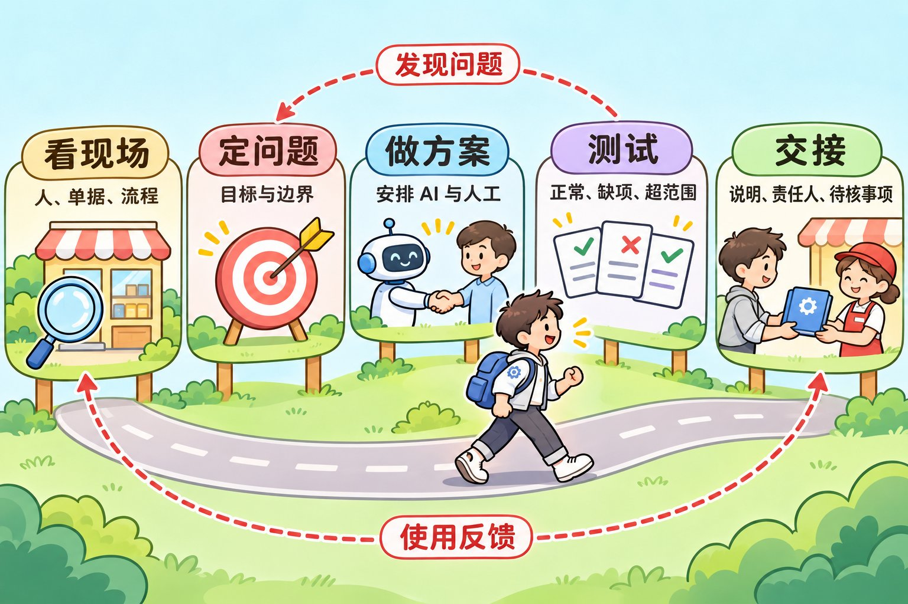

# 第 1 章 FDE 是做什么的
一家水果供应链企业的财务需要核对账目。纸质单据、客户系统回单和几张日表分散在不同地方，财务人员要找出彼此对应的记录。老板想用人工智能（AI）解决对账问题。我们先不猜 AI 能做多少，而要看记录怎样对应、结论怎样核实。

工具给出一份答案，不等于记录已经对上。财务还要看得到依据，知道差异由谁复核。怎样才算把 AI 用进了业务，而不只是做了一个演示？**前线部署工程师**（Forward Deployed Engineer，FDE）会贴近客户的实际工作，理解流程，再与客户一起把技术方案带进日常使用。

本章把一次交付拆成五步：看现场、定问题、做方案、测试和交接，也会比较 FDE 与售前演示人员的工作。你将练习看证据，判断演示是否已经变成业务可用的结果。

## 本章学习目标

读完本章，你应该能：

1. 列举 FDE 一次交付的主要步骤：看现场、定问题、做方案、测试、交接。
2. 用自己的话解释 FDE 和售前演示人员的工作有什么不同，并举出一个「演示完成但业务用不上」的例子。

## 1.1 先弄明白

### 演示跑通，为什么还不够

想象你在一家小店帮忙。店员拿一张准备好的订单给 AI 看，系统马上整理出商品和数量。大家觉得演示不错。

第二天，真正的订单来了。照片有反光，商品名又是店里的简称。店员看不准结果，只好重新抄回旧表。工具演示成功了，店里的活却没变轻。

这是虚构示例。它提醒你，展示一次能力和改变日常工作是两回事。

本章说的**业务结果**，就是用户能在日常流程里完成原本要做的事。用户还要知道结果来自哪里，遇到例外该找谁。

比如，小店员工看完结果后，不用再把全部内容抄回旧表。碰到不清楚的字段，也知道该停下核对。这样你才有机会判断工具帮上了忙。

**成功标准**是开工前约好的检查办法，用来判断问题是否变好。你可以看用户是否用得上结果，缺少信息时是否收到提醒，出了问题是否知道找谁处理。

你也可以把它想成比赛的计分规则。开始前先说好看什么，结束后才不必凭掌声决定输赢。业务改进也要有这样的共同标准。

演示画面只能说明一次尝试得到了结果。它不能代替日常使用和例外处理的证据。

**智能体**是一种能按任务说明处理材料、给出结果的软件。得到许可后，它还可以执行某些动作。

但智能体不替人承担业务责任。结果会影响客户记录或决定时，要由有权限的人检查并确认。

FDE 要把任务、材料和边界交代清楚。然后用证据检查方案能不能应对真实工作里的变化。

**停一下，想一想**：店员看不准结果，只好重新抄回旧表。这次演示的结果，对店里的活有没有帮上忙？

<details><summary>看答案</summary>

没有。店员还要把结果抄回旧表，店里的活没有变轻。

</details>

一句话记住：演示跑通只是一次尝试，是否进入业务要看日常使用和例外处理的证据。

### FDE 贴近谁的工作

**现场**不只是一间办公室，而是工作实际发生的地方：用户接单、看单据、进系统，再把事情交给同事。

现场还包括没有写进流程图的小习惯。有人会在交接时口头补充，也有人会把待核的单据先放一边。你要问清这些做法，才能看见纸面流程和实际流程的差别。

你做小组作业时也会遇到类似问题。组长说「资料整理太慢」，还没说明卡在哪一步。你得看看谁找资料、谁汇总、谁在等结果。

FDE 也要这样看工作。客户说「想要一个 AI 助手」只是线索，不一定是真正的问题。你要看使用的人、手里的材料和事情怎样交接。

范冰《前线部署工程师》强调，工程力量要靠近客户的问题，减少需求层层转述后走样。 OpenAI 介绍的工作从了解客户流程、确定目标开始，接着把方案放进实际使用，再总结可复用的方法。 Intuit 的一则岗位描述写到发现问题、做**原型**（先试想法的初步版本）、实施方案，还包括评估、培训、文档和后续采用。

这些材料说明，FDE 的工作不只是在客户面前展示产品。它还要把方案带进客户的工作，让团队能继续使用。

本章把一次交付整理成五步：看现场、定问题、做方案、测试、交接。这张工作地图帮你检查一项工作有没有漏掉重要环节。

把五步记在心里，像是准备社团活动时先核对场地、人员和物资。漏掉其中一项，活动当天就可能卡住。五步不是通关表，而是提醒你哪些事要看。

项目不一定按直线走完五步。测试发现问题后，团队可能要重新看流程，缩小问题，或调整方案。

OpenAI 的介绍强调流程、目标、实际使用和后续推广。Anthropic 的训练项目则让学员从选择场景、安全审查练到交接。

一句话记住：FDE 要把方案带进客户的工作，让团队能继续使用。

### 从看现场到交接

**看现场**，是先弄清谁在做事、用了什么材料、前后交给谁，以及哪里需要人工判断。

客户说「想要一个 AI 助手」，你先别急着选工具。你可以问：谁会用它？他们现在怎样做？要看哪些单据？发现差异后由谁确认？

比如小店老板说想自动读订单。你还要看订单从哪里来，谁确认商品简称，数量不对时现在怎么处理。

先看这些细节，能避免把一句愿望直接当成技术任务。

**定问题**，是把线索变成范围清楚、可以检查的问题。

「让全公司都用 AI」范围太大，很难知道从哪里开始。你可以先问：哪类工作最费时间？现在由谁完成？哪些错误会带来麻烦？

再问一句：如果先改善一个环节，谁会实际使用？你和业务人员要把目标、限制和责任说清楚。

有些地方暂时没有证据，也要直接标出来。这样团队不会把猜测当成确定事实。

范围清楚以后，团队可以先选一个具体环节。问题越具体，越容易确定参与人员、所需材料和回头检查的证据。

在小组作业中，「大家要快一点」还不够具体。若问题是「交稿后总要等很久才能合并」，你就知道该观察哪个环节。

**做方案**，才是决定技术怎样帮忙。你先安排工具在工作流程中的位置，再考虑选什么工具。

方案不必一开始就让智能体包办所有事情。它可以先整理信息、标出缺项，再由人来判断。

有些规则固定的任务，普通软件可能更合适。有些材料变化多的任务，智能体可以先整理线索。责任重大的判断则要留给掌握情况的人。

就像请同学帮你整理班级活动资料。你不能只说「弄一下」，还要给他名单、规则、格式和上交时间。

对智能体也是一样。任务说明和业务材料，就是交代工作的依据。说明不清、材料不足，结果就更难核对。

所以方案要讲清四件事：谁在什么步骤使用它，输入是什么，结果交给谁，不确定时怎么办。

输出也要照顾使用者。财务逐笔复核时，结果应保留对应单据和待确认事项。只给一个看似完整的结论，反而会让人无从检查。

虚构示例：配送员按固定规则分配路线，普通软件可能更合适。财务从多种回单中找差异，智能体可以先整理线索。判断货损责任，则需要了解现场的人来处理。

关键不是给每件事贴上「AI」标签。你要看任务变化、手头材料和可能后果，再和客户商量哪些步骤能交给工具。

**测试**，是用多种情况检查方案，而不是反复展示同一份材料。

先测正常情况，再测材料缺项时会怎样。你还要看遇到超出范围的要求时，工具会不会停下来请人处理。

比如，你可以先测资料齐全的单据，再测缺少日期的单据。还可以试试工具不认识的商品名称，看它会标出不确定，还是自行补答案。

只在同一份演示材料上成功，不能说明换个人、换一张单据也能用。

你可以把每条测试结果记下来，并注明依据来自哪份材料。这样客户能回看判断过程，材料变化时也能重新检查。

测试不是为了证明 AI 永远正确。它要帮你找出哪些情况能用，哪些情况需要人接手。

**交接**，是把做法交给客户团队，让他们知道怎样开始、怎样核对、出了问题找谁。

还要说清哪些情况没有验证。这样客户就能区分已确认的做法和仍待检查的部分。

用户换人时，操作说明也能帮新同事接手。若有没测过的情况，就标出适用范围，别让客户以为所有问题都已覆盖。

交接时，把谁负责核对、谁处理异常讲明白。给客户的说明要能照着操作，不应只留下工程团队看得懂的技术记录。

如果只有 FDE 本人会操作，客户每天还得等外部工程师代劳，工作就没有交接好。

Palantir 一位前线软件工程师会和客户配置平台，设计并测试工作流，也把现场经验分享给产品团队。

**停一下，想一想**：客户说「想要一个 AI 助手」时，你先问什么？

<details><summary>看答案</summary>

先问谁会用它、他们现在怎样做，以及要看哪些单据。

</details>

一句话记住：交接是把做法交给客户团队，让他们能自己接着用。

### 角色不只看岗位名称

**售前演示人员**主要在客户决定购买前介绍产品。FDE 通常还会走进客户的实际流程。他要弄清问题、安排方案、检查结果，再完成交接。

两种角色都可能展示产品。售前演示帮助客户判断要不要购买。FDE 展示原型，则可能是在检验一个业务想法。

OpenAI 和 Intuit 的公开材料都提到理解客户流程、确定目标、测试方案，并支持客户持续使用。

软件开发人员也可能和客户讨论。FDE 也可能写代码或配置软件。只看「谁写代码」，分不清角色。

同一个人也可能在不同阶段做不同的事。讲解产品能力时，他在做演示。进入客户流程并调整方案时，他就在参与交付。

判断一个人的角色，可以先问他主要对什么结果负责。还可以问他服务谁、交付范围有多大。

Palantir 的岗位文章把传统软件工程师描述为面向多名客户建设一种通用能力。文章把前线角色描述为面向一名客户组合多种能力。

实际团队里的几种角色可能重叠。你要看每个人负责的目标和交付，不能只看职位名称。

**停一下，想一想**：一个人在演示时讲解了产品能力，他一定是售前演示人员吗？

<details><summary>看答案</summary>

不一定。要看他主要负责什么目标和交付。FDE 也可能展示原型。

</details>



*图 1-1：FDE 一次交付的入门工作地图。反馈可能让工作回到前面的步骤。*

### 用水果供应链案例作预告

本书后面会贯穿一家水果供应链企业的案例。它采购水果，在仓库按批次管理，再按订单分装和配送。发货后还要核对实收、退货、报损和结算。

案例记录显示，2026 年 8 月 9 日开始了业务访谈。8 月 10 日接受了一项方案设计。

8 月 30 至 31 日，团队在受控环境里测试了从输入材料到结果的整条流程。受控环境，就是条件由团队自己设定的环境。这类**端到端测试**，就是按实际操作顺序一路检查到结果。测试有助于检查操作，但不能代替客户实际使用。

9 月 27 日的记录仍说方案没有交给客户日常使用。10 月 30 日的演示回放还记录了确认和导出环节的问题。

访谈说明团队了解了什么，设计记录说明作了什么决定，测试记录说明流程在相应环境里跑过。它们的证据用途不同。

本章把方案交给客户在日常业务中使用，称为**正式上线**。现有材料没有证明方案已经正式上线，也没有证明客户验收。

所以，这个案例适合用来练习区分发现、设计、测试和交接的证据。我们不会把做出方案写成已经取得业务成果。

## 1.2 看例子

#### 例 1-1：从岗位描述看 FDE 在做什么
<!-- Bloom：理解 -->

**材料**：下面是对 Intuit 一则「Staff Forward Deployed Engineer, AI-Powered Work」岗位描述的改写摘要，不是原文引文：工程师要了解员工当前的工作方式和交接，和业务伙伴选择问题、确定成功标准；先做原型检查假设，再实现方案；还要安排评估、培训、文档和后续支持。

**题目**：阅读这则岗位描述摘要，用自己的话概括 FDE 的工作内容。说明材料能支持什么结论，又不能支持什么结论。

**解**：

1. 先看材料类型。这是招聘岗位描述，说明雇主希望这个岗位负责什么，不是某位工程师一天从早到晚的活动记录。
2. 再找工作起点。材料写到了解员工怎样工作、选择高价值问题、确定成功标准，所以工作从理解问题开始，不是拿到一句需求就直接做系统。
3. 再看工作过程。先用原型检查假设，再实现方案、安排评估，说明 FDE 要把想法带到可检查的方案，而不是只作口头建议。
4. 最后看终点。培训、文档和支持表示交付还包含让团队继续使用。综合起来，这个岗位要把模糊业务需要逐步变成能使用、能检查、有人接手的方案。
5. 结论要有边界：这则材料不能证明所有 FDE 都做完全相同的工作，也不能推出他们每天固定花多少时间在某一项任务上。

<details><summary>这个答案是怎么核对的</summary>

**验证**：✅ 已验证（核对 Intuit 岗位描述原文）

```text
核验记录：回到书末参考文献第 1 章第 2 条原文的 Job Overview 与 Responsibilities。原文依次列出了解现有工作流程、选择问题和成功标准、测试原型、实施、评估、培训、文档与支持。题目结论只依赖这些岗位职责；“不能推出逐小时日程”是对材料类型的范围判断。
```

</details>

回顾：这段研读先确认材料是什么，再分出它能支持的结论和不能支持的结论。

#### 例 1-2：演示成功与业务可用
<!-- Bloom：分析 -->

**材料（虚构示例）**：记录甲：供应商在会议室用预先准备的订单图片演示，系统整理出商品和数量，现场人员表示效果不错；记录没有提到日常用户是否使用、错误如何处理或谁负责核对。记录乙：试用团队把工具放进日常订单流程，输出能回到对应原单；缺少供应商信息时系统标出待确认，员工按已有流程复核，并把无法处理的情况交给负责人。两段记录均为虚构，不代表真实客户项目。

**题目**：比较两段记录，说明「演示成功」和「业务可用」的证据差在哪里。

**解**：

1. 先把判断标准说清楚：演示成功说明在准备好的条件下展示出一种能力；业务可用还要有用户、实际流程和核对办法的证据。
2. 看记录甲。它说明系统在预先准备的订单图片上给出了结果，也有人当场认可；但没有写日常使用、错误处理或责任安排。因此，甲支持「这次展示跑通」，不支持「客户每天能用它完成工作」。
3. 看记录乙。它提到工具进入日常流程、结果能追到原单、缺信息时会停下来请员工核对，也说明了例外交给谁处理。这些信息支持「有业务使用条件和人工兜底」的判断。
4. 仍要留出边界：乙比甲更接近业务可用，但这段记录没有说明使用是否持续、工作效果是否达到约定目标，也不能代替正式验收。

<details><summary>这个答案是怎么核对的</summary>

**验证**：✅ 已验证（逐项核对题内虚构记录与本章判断标准）

```text
核验记录：记录甲只写预备图片、现场输出和即时反馈；没有日常流程、异常处理或责任人。记录乙明确写入日常流程、原单追溯、缺项复核和负责人。结论没有依赖材料以外的客户事实；“还不能证明最终成功”由乙未提供持续使用或目标达成证据得出。
```

</details>

回顾：这次比较把材料明写的证据与我们希望知道、但材料没有交代的事分开了。

## 1.3 跟着练

#### 例 1-3：把交付步骤放进水果案例时间线（引导练习）
<!-- Bloom：理解 -->

**材料**：贯穿案例档案记载，2026 年 8 月 9 日进行了业务访谈；8 月 10 日接受了方案设计；8 月 30 至 31 日在受控环境进行端到端测试；9 月 27 日的记录仍说没有交给客户使用；10 月 30 日的演示回放记录了确认和导出环节的问题。档案没有证明客户正式验收。

**题目**：把这些记录与「看现场、定问题、做方案、测试、交接」五步对应。哪一步有明确记录？哪一步仍缺少完成证据？

<details><summary>提示 1（切入角度）</summary>

先看每条记录写的是访谈、方案、测试还是交付；不要只凭日期顺序判断工作已经完成。

</details>

<details><summary>提示 2（关键证据）</summary>

9 月 27 日的记录明确说当时还没有交给客户使用。把这条与 10 月 30 日仍有确认和导出问题的回放放在一起看。

</details>

<details><summary>完整解答</summary>

**解**：

一、8 月 9 日的访谈对应「看现场」。它也为「定问题」提供材料，但时间线没有单独证明问题范围已形成正式确认稿。

二、8 月 10 日接受方案设计，对应「做方案」。这说明作出了设计决定，不等于方案已经交付。

三、8 月 30 至 31 日的受控端到端测试对应「测试」，但测试环境与证据范围有限。

四、9 月 27 日记录写明当时未交给客户使用。10 月 30 日回放仍有确认和导出问题。

五、因此，案例档案中没有足够证据把「交接」标成已完成，也没有客户正式验收的证明。

**验证**：✅ 已验证（核对贯穿案例档案第六节时间线）

```text
核验记录：逐条对照档案记录的 2026-08-09 访谈、08-10 设计决策、08-30 至 08-31 受控测试、09-27“尚未交给客户使用”及 10-30 演示回放。档案另说明没有正式客户验收记录。答案没有把设计或测试写成验收。
```

</details>

#### 例 1-4：辨认三种角色的工作重点（引导练习）
<!-- Bloom：分析 -->

**材料（虚构示例）**：一家公司要改善订单处理。甲在签约前展示产品能识别一张准备好的订单，帮助客户了解方案可能做到什么。乙在项目开始后观察员工怎样接单、核对和处理缺项，确定先解决的问题，和团队一起调整方案并检查使用结果。丙负责把经过验证、多个客户都可能需要的订单组件做成产品功能。团队中三个人会互相讨论，也可能共同参加演示。

**题目**：判断甲、乙、丙分别最接近售前演示人员、FDE、软件开发人员中的哪一种角色。说明依据，并指出为什么不能只凭「谁参加了演示」来判断。

<details><summary>提示 1（切入角度）</summary>

比较每个人的工作目标和发生阶段，不要只看他们是否接触客户或写软件。

</details>

<details><summary>提示 2（关键证据）</summary>

甲发生在签约前；乙对一个客户的问题从发现延伸到使用；丙做的是可能给多个客户使用的产品能力。

</details>

<details><summary>完整解答</summary>

**解**：

一、甲最接近售前演示人员，因为他的任务是签约前介绍产品能力。

二、乙最接近 FDE，因为他进入客户的实际流程，和团队确定问题、调整方案并检查使用结果。

三、丙最接近软件开发人员，因为他把验证过的通用组件做成可复用的产品功能。

四、参加演示本身不能决定角色。FDE 也可能展示原型，软件开发人员也可能参与讨论。关键要看此人在项目中负责什么目标和交付。

五、这是一种便于入门的角色区分，实际团队的职责可能重叠。Palantir 的介绍区分了两类工程角色：一类面向多客户建设单项通用能力，另一类面向单一客户组合多项能力。 其他公司的分工可能不同。

**验证**：✅ 已验证（核对本章角色约定与 Palantir 岗位介绍）

```text
核验记录：题内甲、乙、丙的阶段与任务是虚构材料中直接给出的。核对书末参考文献第 1 章第 4 条的岗位介绍，可见其将传统软件工程师描述为面向多客户做单一能力，将前线软件工程师描述为面向一个客户组合多项能力。答案只把这一区分作为例子，并注明不代表所有公司。
```

</details>

## 1.4 自己做

先自己做，做完再翻到 [98-参考答案.md](98-参考答案.md) 对照。

#### 习题 1-1
<!-- Bloom：记忆 -->

**题目**：按本章的工作地图，依次列出 FDE 一次交付的五个主要步骤。

#### 习题 1-2
<!-- Bloom：理解 -->

**题目**：用自己的话说明 FDE 和售前演示人员的工作有什么不同，并举一个「演示完成但业务用不上」的例子。例子可以来自校园、家庭或普通工作场景，并说明缺少了哪类证据。

#### 习题 1-3
<!-- Bloom：分析 -->

**材料（虚构示例）**：

- 记录甲：演示人员用准备好的订单图片展示识别结果；没有日常用户、异常处理或后续交接记录。
- 记录乙：员工把工具用于日常订单，结果能追到原单，缺少信息时由员工核对；记录没有说明是否持续使用或是否达到目标。
- 记录丙：方案经过多种输入测试，用户知道如何复核，明确了遇到问题找谁，并记录了尚未验证的情况。

**题目**：判断哪一段只能支持「演示完成」，指出另两段分别多了什么证据，并说明这些证据仍不能证明什么。

#### 习题 1-4
<!-- Bloom：评价 -->

**题目（开放题）**：有人说：「客户看完演示鼓了掌，项目就成功了。」评估这个说法的证据够不够。请提出你的判断，说明还需要看到哪些证据，并回应一种可能的反方意见。

| 评价维度 | 充分 | 部分 | 尚未体现 |
|---|---|---|---|
| 实际使用证据 | 区分掌声与日常使用，提出至少两类可回查的工作证据，并说明它们与目标的关系。 | 提到要看实际使用，但没有指出具体证据或它与目标的关系。 | 把掌声或一次演示直接当作业务成功。 |
| 测试与结论边界 | 指出至少两类需要检查的情况（如正常输入、缺项或超范围），并说明目前结论的限制。 | 提到要测试，但只说明一类情况或没有说明结论限制。 | 没有提出测试证据，或称一次演示就能证明稳定可靠。 |
| 人的责任与交接 | 说明由谁核对重要结果、例外由谁处理，以及客户团队怎样接手。 | 提到人工核对，但未说明责任人或交接方式。 | 把重要判断完全交给智能体，或没有说明由谁负责。 |
| 反方回应 | 承认鼓掌可作为兴趣或初步反馈，并说明为什么它仍不足以证明业务成功。 | 提到不同看法，但没有解释它与成功证据的关系。 | 没有回应不同看法。 |

## 1.5 本周实训

虚构示例：你是一名 FDE，客户是海桥鲜果。你正在做客户发现工作，要把访谈材料整理成可核对的业务简介，交给客户业务负责人核对，也供项目团队继续界定问题。

**实训目标**：先请 DeepSeek Harness（简称 `dsh`，本实训用来与智能体对话的工具）根据课堂材料整理一页客户简介。再逐句回到原材料核对，并标出自己修改的地方。本实训只用下方虚构示例，不接触客户原始资料，也不让智能体读取本机文件或修改业务记录。

**准备**：电脑已由教师装好 `dsh`。请使用教师发给你的 VectA 账号。本实训只使用下方的虚构材料。

**课堂材料（虚构示例）**：

> 海桥鲜果为附近餐饮店采购和配送水果。采购员向供应商下单，仓库员工收货并记录批次；订单确认后，员工按订单拣货，司机送货。财务人员根据客户签收资料核对实收、退货和报损。材料没有提供员工人数、订单量、现用软件、当前成本、经营结果或客户是否使用 AI。

**分步操作**（建议用两课时完成）：

1. 按教师提供的入口打开预装的 `dsh`。

2. 用教师发给你的 VectA 账号登录。若无法登录，停止操作并告知教师，不要尝试更改模型设置或借用他人账号。

3. 在 `dsh` 对话中开始新一轮交流。

4. 把下面的任务说明和课堂材料粘贴进去。不要上传客户文件，也不要粘贴真实客户信息。任务说明是：「请只根据我提供的材料，整理一页客户简介，分成客户做什么、参与角色与流程、材料明确写出的事实、材料没有提供的信息、需要向客户追问的问题。每个事实后标出对应的材料依据；材料没说的内容写『材料未提供』，不要猜。」

5. 阅读智能体返回的客户简介草稿，保存或抄下原始版本，作为 FDE 待核对的初稿。

6. 不要因为语句流畅就直接采用，也不要让它补写材料没有提供的经营数字或客户结论。

7. 作为 FDE，把简介中的每句话与课堂材料逐条对照，在旁边标记「有原文依据」「说得比原文多」或「材料未提供」。

8. 遇到不准确或无依据的内容，自己改正，并把修改位置加粗或标上「【我修改】」。

9. 将核对后的内容整理成一页客户简介，供海桥鲜果的业务负责人核对。

10. 保留至少一处明确修改记录，并另用一两句话说明智能体最容易把哪项材料说多了，以及你用什么依据改回去。
**要交的产物**：一页客户简介，包含业务概况、角色与流程、已知事实、未知信息和待追问事项；附上原始输出与修订稿的对照，清楚标出自己修改的地方。

**检查清单**：

- [ ] 每条业务事实都能在课堂材料中找到依据。
- [ ] 员工人数、订单量、软件名称、成本、经营效果等未提供的信息没有被补写成事实。
- [ ] 角色、流程顺序和交接关系没有被智能体混淆。
- [ ] 至少标出一处自己修改的地方，并写清修改依据。
- [ ] 简介没有包含真实客户信息、账号密码或未经授权的业务记录。

## 本章小结

**核心结论**：

1. 演示跑通只能说明某次展示成功；判断 AI 是否进入业务，还要看用户能否在日常流程中使用、核对并处理例外。
2. FDE 的工作从了解现场和界定问题开始，经过方案与测试，最后交接给客户团队；反馈也可能让工作回到前面的步骤。
3. FDE、售前演示人员和软件开发人员的任务重点不同，但具体分工会因团队而重叠。判断角色要看负责的目标和交付，不能只看是否参加演示。
4. 结论要跟着证据走。没有实际使用、异常处理和交接证据时，不把演示称为业务成功。

**和全书主线的关系**：本章推进了「演示时跑通一次，和客户每天能用它把活干完，是两回事」。读者开始用实际使用和可核对的证据判断 FDE 的工作结果。本章也推进了「客户嘴上说的需求常常不是真正的问题，要去看实际的人、单据和流程」。1.1「看现场」说明 FDE 怎样观察真实工作。

**自检**：回到章首的学习目标，逐条问自己做到了没有——

- [ ] 列举 FDE 一次交付的主要步骤：看现场、定问题、做方案、测试、交接。→ 拿不准就回看 1.1，自测：习题 1-1。
- [ ] 用自己的话解释 FDE 和售前演示人员的工作有什么不同，并举出一个「演示完成但业务用不上」的例子。→ 拿不准就回看 1.1，自测：习题 1-2。

**下一章预告**：第 2 章《该不该用 AI》将带你判断一件事该交给智能体、普通软件，还是留给人。
