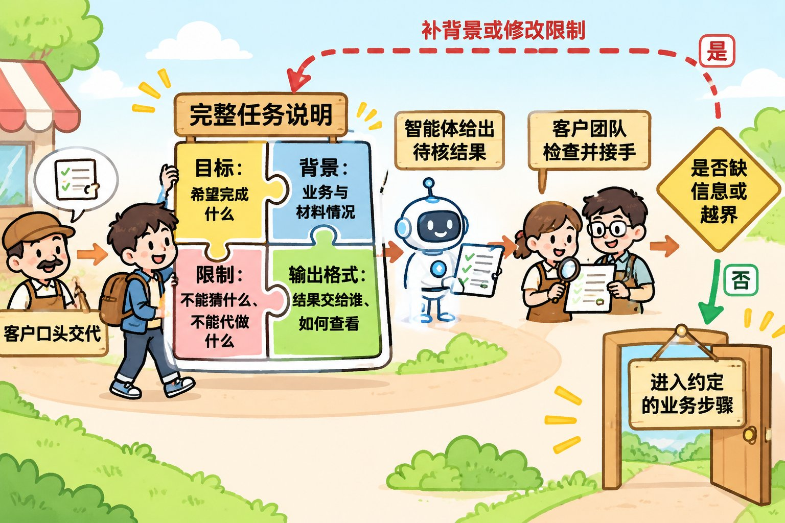

# 第 3 章 把客户的活交代清楚

到了客户现场，你常会听到一句：「把这些留言整理一下。」听起来很简单，可它没说要得到什么，也没说哪些信息不能猜。

本章要解决的问题是：怎样把这样的口头要求，写成智能体看得懂的交代。你会学着先想清目标、背景、限制和输出格式四件事。

读完本章，你能把客户的一句口头要求改写成四部分齐全的说明，并比较改写前后的结果。

## 本章学习目标

读完本章，你应该能：

1. 把客户交代的一项业务任务写成给智能体使用的说明，包含目标、背景、限制和输出格式四部分。

## 3.1 先弄明白

### 任务说明不是「多说几句」

客户交代工作时，往往先说想要的结果：「帮我看看这些留言」「把表格理一理」。熟悉业务的同事听了，通常能接着做下去。因为同事知道资料从哪来、要交给谁，也知道哪些事不能替客户决定。

智能体没有这段共同经历。FDE 要把口头要求里的关键信息写出来。这样智能体才知道该做什么、依据什么、不能越过哪条线，以及结果交给谁。

**提示**是给智能体的文字指令，告诉它这次要做什么、有什么要求。**任务说明**是更完整的一份工作交代，通常把目标、背景、限制和输出格式放在一起。

你可以把它想成一张交接单。只写「请处理」，就像把一袋材料放到桌上；写清四部分，接手的人才知道要做哪一步、材料从哪来、缺项怎么办，最后交成什么样。

任务说明不是越长越好。客户的一段话可以写得很长，却仍没说明判断依据；一张短表也可能四项齐全。关键在于每句话是否帮助智能体完成眼前这项业务，而不是把所有客户资料都塞进来。

FDE 的现场工作会把这项写作变得具体。Intuit 的一份岗位说明中，FDE 的职责包括了解工作流程、决策、交接、来源系统和例外。说明也提到业务资料、固定格式结果和审批步骤。但这只是一个岗位的描述，不代表所有公司的统一做法。

Salesforce Trailhead 的公开课程简介，把服务智能体的情境概括为协助预约和推荐。 这样的名称只说明大致在做什么。它没有说明用哪份资料、能替客户决定到哪一步、结果交给谁。FDE 需要继续把这些问题问清楚。

一句话记住：任务说明要写的是帮智能体完成眼前这项业务的信息，多写不等于写清楚。

### 一、目标：说清希望得到什么

**目标**是这次希望智能体完成的具体工作。写目标时，先找出动作，再说清处理对象和结果用途。「整理留言」只有动作，没有说明整理成什么。「从来电记录中提取顾客诉求和待确认事项」说清了动作和对象。「供客服主管安排回访」说清了结果的用途。

目标也帮助 FDE 分清不同工作。把内容归类、提取信息、生成待核清单，可以先交给智能体协助。替客户答应退款、直接改正式记录，则涉及业务决定。

客户说「处理好」，不能自动理解成可以代替员工做决定。目标要写出希望得到的结果，也要让人看得出谁会使用它。

一个好目标尽量可以检查。「让服务更好」很难判断是否做到。「把每条留言中的问题、已经说明的事实和需要追问的信息分开列出」，就能逐项检查。若客户暂时说不清什么算完成，FDE 可以先把目标写成草案，带回客户现场确认。不要替客户补出一个标准。

**停一下，想一想**：「把留言整理一下」缺了哪些信息？

看答案

只有动作「整理」。它没有写整理成什么，也没有说明结果供谁用。

一句话记住：目标要写成动作、对象和用途，写到能逐项检查为止。

### 二、背景：补上这项工作发生的现场

**背景**是智能体完成任务前需要知道的业务情况。提示设计中也常把这类已有信息叫作**上下文**。它包括材料来自哪里、材料大致有什么、结果给谁看，以及这一步在客户流程中的位置。

背景回答「为什么要这样做」。同一批顾客留言，如果结果用于晨会安排回访，重点可能是待追问事项。如果结果用于月底统计，重点可能是问题类别。目标都叫「整理留言」，用途不同，输出就会不同。

背景应来自客户现场已确认的信息和本次提供的材料。比如 FDE 观察到每条来电记录是一段文字，部分记录没有日期；这可以写进背景。若不知道门店的退换政策，就不能把某个规则写成事实。没有的信息应标出「未提供」或先问客户，不要用常识替客户填空。

背景也不等于把全部资料交给智能体。先问这份资料是否和当前目标有关，再确定是否可以提供。对一项来电整理任务，客户的完整通讯录通常不是必要背景。把范围收小，既减少无关内容，也更容易发现缺了哪项材料。

一句话记住：背景交代的是这项工作发生的现场，只给和目标有关的材料。

### 三、限制：划清不能猜、不能代做的事

**限制**是这项任务必须遵守的边界。它可以说明哪些来源才可使用、信息缺失时怎样处理。它还可以说明哪些结论不能下，以及什么动作必须由人确认。限制不是附加的客套话，而是让结果留在合适范围内的工作要求。

例如，客户只给了一句「开关时好时坏」。智能体可以把这句话整理成已知描述。但它不能据此认定商品已经损坏，也不能认定符合换货条件。

FDE 可以要求它只引用记录中的事实。缺少购买时间时，写「待确认」。建议后续核对的内容，标成草案。这样，读者能分清原材料说了什么，哪些内容还需员工判断。

**停一下，想一想**：客户只说「开关时好时坏」，智能体能不能据此写出「商品已经损坏」？

看答案

不能。智能体只能把它整理成已知描述；认定商品是否损坏，要由员工判断。

限制还要分清「建议」和「执行」。如果这一步只是整理待回访事项，就不能让智能体把建议写成已经答应客户的承诺。若后续工作涉及改变正式记录或影响客户权益，应由有权限的人核对并确认。智能体能写出一句话，不等于它获得了替客户作决定的权限。

限制写得太松，结果可能把推测混进事实。写得太紧，也可能让智能体无法完成任务。FDE 可以把不能确定的部分单列出来，请客户说明业务规则或指定负责人。目标不是让智能体「什么都不做」，而是让它在许可的范围内完成可交代的工作。

一句话记住：限制要写清三件事，即不能猜什么、不能代做什么，以及哪里要人确认。

### 四、输出格式：让结果能被接手

**输出格式**是结果呈现的样子和栏目安排。**结构化输出**是按事先约定的栏目组织信息。例如一行一条记录，并固定列出四个栏目：「顾客诉求」「已知事实」「待确认事项」「建议下一步」。它像一张填写好的工作表，方便员工逐项查看，而不是从一大段文字里重新找重点。

输出格式要从使用者的下一步工作倒推。客服主管要安排回访，就需要看到每条记录的问题和缺少什么。还要知道下一步要联系谁，或核实什么。如果他们还不能确定负责人，格式就可以写「待安排」，而不是让智能体编一个名字。

每个栏目都要说清含义。比如「处理结果」，可能指已经办完的事，也可能指建议。用「建议下一步（草案）」，就不容易和实际决定混淆。「未知事项」也要约定怎么写，例如统一填「待确认」。格式越清楚，越方便人发现空白和越界内容。

**停一下，想一想**：为什么要把「处理结果」改成「建议下一步（草案）」？

看答案

「处理结果」可能被读成已经办完的事。改成「建议下一步（草案）」，就能和实际决定分开。

栏目不必越多越好。每项都应服务一个检查或交接动作。

记录编号能帮助员工找回原材料。已知事实显示内容依据。待确认事项提示下一步追问。建议下一步保留为草案。与回访无关的资料不需要为了显得完整而加入。

一句话记住：每个栏目都要服务员工的一个检查或交接动作，并且说清它的含义。

### 五、四部分要一起看

目标、背景、限制和输出格式各自回答不同问题。目标说要做什么，背景说在什么业务现场做。限制说哪些内容不能猜或代做，输出格式说结果怎么交给使用者。

只写目标，智能体可能不知道依据。只写限制，它可能不知道任务是什么。没有格式，结果也未必能接进员工的工作。

下面是一份可以继续和客户核对的虚构说明：

> **目标**：把收到的维修留言整理成待回访清单，供店长安排客服后续联系。  
> **背景**：每条材料是一段顾客留言；本次只提供这些留言，没有订单或检测记录。  
> **限制**：只整理材料明确写出的内容；缺少的信息标「待确认」；不要判断商品故障或承诺更换。建议只作为草案。  
> **输出格式**：每条一行，包含「记录编号、顾客诉求、已知事实、待确认事项、建议下一步」。

这份说明没有替店长决定怎样处理维修，也没有假装掌握订单和检测资料。客户还可以补充字段、业务规则或审批人。FDE 应把这些待确认项带回现场，而不是让智能体自行补齐。

*图 3-1：四部分合成任务说明，结果仍由客户团队检查并接手。*

写完后，FDE 可以用四个问题自查。要得到的结果是否清楚？需要哪些业务背景和材料？

缺信息时怎么办，哪些事不能代做？结果按什么栏目交给谁？若其中一项答不出，就先补问，或把它标成待确认。

试用结果也要回到这四个问题。若输出漏了「待确认事项」，先检查任务说明有没有规定这个栏目。若智能体猜了购买日期，先看背景里有没有提供日期。再看限制里是否要求缺项留空。

改说明或补材料后再观察结果，才能知道哪处变化有用。反复重试同一句话，只会让人难以判断问题出在哪里。

这一步体现了本章的主线。智能体是按任务说明处理材料的工具，FDE 负责把客户的工作和材料交代清楚。

一句话记住：从说明和结果中找出四部分，再判断措辞变化带来什么差别，是 FDE 读懂任务说明的基本功。

## 3.2 看例子

#### 例 3-1：从任务说明中找出四部分
<!-- Bloom：理解 -->

**题目**：阅读下面这份虚构任务说明，指出目标、背景、限制和输出格式分别在哪里，并说明每一部分提供了什么信息。

> **目标**：把当天的顾客来电整理成回访清单，供客服主管安排工作。  
> **背景**：每段材料是一条来电记录，内容可能不完整。  
> **限制**：只依据记录；没有写到的信息填「待确认」；不替员工答应退款或换货。  
> **输出格式**：每条列出「顾客诉求、已知事实、待确认事项、建议下一步」。

**研读**：

1. 先确认材料性质。题面说明它是虚构任务说明，所以我们分析的是给智能体的工作交代，不把它当成真实客户记录。
2. 再找目标。第一栏的「整理成回访清单」说明要完成什么；「供客服主管安排工作」说明结果的用途。
3. 接着找背景。第二栏交代了材料的来源和特点：每段是一条来电记录，而且可能缺信息。它解释了为什么输出需要保留待确认项。
4. 然后检查限制。第三栏规定只依据记录，缺项不能猜，也不能替员工答应退款或换货。这是对推断和业务决定的边界。
5. 最后找输出格式。第四栏列出固定栏目，说明结果如何呈现。它和目标相连：主管要安排回访，因此需要看到诉求和下一步。

这份说明四项齐全，但仍不能证明某个具体结果正确。实际使用时，客服主管还要检查材料有没有提供足够依据，特别是待确认信息有没有被误写成事实。

这个答案是怎么核对的

**验证**：✅ 已验证（逐句对照题面中的四个标注栏目）

**核验记录**：目标、背景、限制和输出格式均由题面直接标出；答案没有引入额外业务事实。

**回顾**：这次研读用到了逐项定位的方法，把一份说明拆成四个不同的问题。

#### 例 3-2：比较限制写法与结果
<!-- Bloom：分析 -->

**题目**：下面是同一条虚构来电材料，以及两版任务说明和教学用的预设结果。指出两版说明的差别，分析哪一处写法与结果差异相对应。注意：结果是为练习而编写的，不是实际调用智能体所得。

**来电材料**：「台灯开关时好时坏，想问能不能换。」

| 项目 | 任务说明 A | 任务说明 B |
|---|---|---|
| 目标 | 整理来电，供售后人员回访 | 整理来电，供售后人员回访 |
| 背景 | 只有这句留言，没有订单或检测记录 | 只有这句留言，没有订单或检测记录 |
| 限制 | 可按常见处理方式补充建议 | 不判断故障或退换资格；缺项标「待确认」；不承诺换新 |
| 输出格式 | 顾客诉求、已知事实、待确认事项、建议下一步 | 顾客诉求、已知事实、待确认事项、建议下一步 |

**预设结果 A**：顾客的台灯质量不合格，建议立即换新。  
**预设结果 B**：顾客询问能否更换台灯。已知事实：顾客称开关时好时坏。待确认：订单和检测情况、适用的售后条件。建议下一步：由售后人员核对后再回复，尚未承诺换新。

**研读**：

1. 先核对共同材料。来电只说开关时好时坏，并询问能否更换；它没有提供检测结论、订单或售后规则。
2. 比较四个栏目。两版目标、背景和输出格式相同，变化集中在「限制」：A 允许按常见方式补建议，B 要求不判断资格、标出缺项且不承诺。
3. 对照两份预设结果。A 把「开关时好时坏」直接写成质量不合格，并建议换新；材料没有支持这两个结论。B 保留顾客原话，列出待核项目，并让售后人员确认。
4. 得出有边界的结论。在这组教学材料里，限制写法与两种结果的差异相对应。由于题面同时给出了预设结果，我们不能据此断言真实智能体每次都会如此回应；实际效果仍要用客户提供的材料检查。

这个答案是怎么核对的

**验证**：✅ 已验证（逐项比较两版说明、共同材料和预设结果）

**核验记录**：两版只有限制栏不同；结果 A 中「质量不合格」和「立即换新」均未出现在来电材料中，结果 B 将其列为待确认。结论只针对题面给出的虚构材料。

**回顾**：这次研读用到了比较法，先锁定两版共同部分，再检查发生变化的栏目。

## 3.3 跟着练

#### 例 3-3（引导练习）：补上任务限制
<!-- Bloom：应用 -->

**题目**：一位虚构的家电维修店店长希望把顾客报修留言整理成回访清单。下面的说明缺少限制，请补上一条限制，避免智能体猜测缺失信息或把建议写成承诺。

> **目标**：把报修留言整理成待回访清单，供店长安排客服联系。  
> **背景**：材料是顾客留下的文字留言，可能没有订单和检测记录。  
> **限制**：__________  
> **输出格式**：每条列出「顾客诉求、已知事实、待确认事项、建议下一步」。

提示 1（方向）

先看材料缺少什么，再想哪些决定应留给店长或客服。

提示 2（关键步骤）

限制至少要包含两件事：缺少的信息怎么写；智能体不能替员工承诺什么。

完整解答

**参考写法**：只根据留言中明确写出的内容整理；没有提供的订单、检测或售后信息标「待确认」，不得推测；不判断是否符合维修或换货条件，也不替店长向顾客承诺。

**验证**：✅ 已验证（对照题目要求检查缺项处理和决定边界）

**核验记录**：参考写法明确要求按原留言整理、为缺项标记待确认，并把售后判断和承诺留给员工，覆盖了题目要求。

#### 例 3-4（引导练习）：诊断含糊的交代
<!-- Bloom：分析 -->

**题目**：店长说：「把这批维修留言处理妥当，给我一份能直接用的结果。」指出至少三处可能被智能体误解的地方，并分别说明可能出现的两种理解。

提示 1（方向）

圈出意思宽泛的动词和没有具体对象的词，再追问它们指什么。

提示 2（关键步骤）

先拆「处理妥当」：它可能只是整理信息，也可能被读成替员工作售后决定。

完整解答

**参考分析**：

1. 「处理妥当」可能指提取诉求和待确认项，也可能指判断是否维修、换货。题目没有说明权限边界。
2. 「能直接用」可能是给店长看的待办清单，也可能是可直接发给顾客的答复。两者的风险和格式不同。
3. 「这批留言」没有说明每条记录的范围、来源和缺项处理方式。智能体可能自行分类，也可能把缺失内容猜出来。
4. FDE 应先问清目标、使用者、可用材料和限制，再约定输出栏目。

**验证**：✅ 已验证（逐词回查题面并检查每处是否有两种合理解释）

**核验记录**：「处理妥当」「能直接用」「这批留言」均来自题面；分析列出的理解分叉是可能解释，不作为客户实际规则。

## 3.4 自己做

先自己做，做完再翻到 [98-参考答案.md](98-参考答案.md) 对照。

#### 习题 3-1
<!-- Bloom：记忆 -->

**题目**：写出一份任务说明的四个组成部分，并用一句话说明每部分回答什么问题。

#### 习题 3-2
<!-- Bloom：应用 -->

**题目**：把下面的客户口头要求写成四部分齐全的任务说明。可以补充合理的栏目安排，但不能把自己补充的内容冒充客户已经确认的规则。

> 虚构客户口述：「早会前，把昨天下午收到的顾客来电整理成回访清单；信息不全的先标出来。」

#### 习题 3-3
<!-- Bloom：应用 -->

**题目**：为「整理客户来电记录」设计一份结构化输出格式，列出每个字段，并各用一句话说明它帮助员工做什么。不要加入完成回访并不需要的个人信息。

#### 习题 3-4
<!-- Bloom：评价 -->

**题目（开放题）**：一家虚构的维修店希望智能体帮助整理顾客来电。比较下面两条任务说明，判断哪一条更适合先交给智能体协助，并说明理由。还要指出选中的说明仍需向客户确认什么。

**说明 A**：「请整理这些来电，给出完整处理建议。」

**说明 B**：目标是提取每条来电中需要回访的问题，供客服主管检查；背景是当天的文字来电摘要，可能有缺项；只根据摘要中写明的信息，缺项标「待确认」，不判断退款或维修资格；按「记录编号、顾客诉求、已知事实、待确认事项、建议下一步（草案）」列出。

| 评价维度 | 优秀 | 合格 | 未达成 |
|---|---|---|---|
| 四部分识别 | 指出目标、背景、限制和格式各自如何支持回访任务 | 指出其中三部分并说明作用 | 只说哪条更详细，没有对应具体组成部分 |
| 依据与责任边界 | 检查信息是否有材料依据，并指出哪些决定应由员工确认 | 注意到缺项或决定边界中的一项 | 把建议当成已确认事实或承诺 |
| 迁移到客户工作 | 能联系到客服主管下一步如何使用结果，并提出一项具体待确认问题 | 能说出结果的使用者或一个待确认问题 | 没有说明谁会用结果，也没有提出待确认问题 |
| 表达与理由 | 用题面中的具体内容支持判断，并说明仍需核实之处 | 有判断理由，但依据或待确认项不够具体 | 只有结论，没有可核对的理由 |

## 3.5 本周实训

你是一名 FDE，正在协助一家虚构的家电维修店。店长希望把顾客口头交代的事情变成客服能查看的回访清单。这是 FDE 发现需求后，验证工作说明是否够清楚的一步。

### 实训目标

- 把同一项口头任务写成两版提示。
- 记录两版具体改了什么，以及实际输出有什么变化。
- 检查输出有没有把缺失信息写成事实，或把建议写成承诺。

### 准备

每组使用教师预装好的 DeepSeek Harness（dsh）和教师分配的 VectA 课堂账号。只使用课堂提供的虚构材料，不输入客户原始资料、真实联系方式或生产数据。教师需先确认账号和练习环境属于获准的独立教学环境。

本次口头要求和材料：

> **店长口述（虚构）**：「把今天收到的维修留言整理一下，给我一份明早能安排回访的清单。信息没写清的不要猜。」  
> **留言材料（虚构）**：「记录 A：冰箱通电后不制冷，顾客希望预约上门；时间和型号没有记录。」

### 分步操作

1. **确认练习边界。** 读一遍口头要求和留言材料，圈出店长明确说过的事。
2. **列出缺口。** 把尚未提供的信息列在纸上，不自行补写维修政策、收费方式或预约时间。
3. **进入课堂工具。** 使用教师分配的 VectA 课堂账号，登录教师预装好的 dsh。
4. **停在可用的地方。** 若登录或课堂环境未经教师确认，停止在线操作，继续完成纸面任务说明。不得改用生产账号或真实客户资料。
5. **写第一版。** 在教师确认的对话入口输入：「整理一下这条维修留言。」
6. **记录第一版结果。** 使用上面的同一段虚构留言，记录实际返回的全部内容。不要把预想结果写成实际结果。
7. **写第二版。** 目标、背景、限制和格式分别写清楚。例如：目标是形成待回访清单；背景是只有一条文字留言、没有时间和型号；限制是只依据留言，缺项标「待确认」，不判断故障原因或承诺预约；格式列出记录编号、顾客诉求、已知事实、待确认事项和建议下一步（草案）。
8. **再次试用。** 将这版说明与同一段留言交给 dsh，记录实际返回内容。
9. **并排比较。** 用表格记录两版说明的差异、两次实际输出的差异，以及仍需店长或客服确认的内容。
10. **检查两个问题。** 第二版是否保留了「时间和型号未记录」，是否把「希望预约」写成已经预约。
11. **工具未运行时。** 若课堂工具未能运行，在结果栏写「未运行，结果待验证」，不编造输出。
12. **（选做）回看并修订。** 选一处最影响使用的差别，说明它对应目标、背景、限制或格式中的哪一项。
13. **（选做）再试一次。** 只改这一项，再次试用并记录第三次结果。
14. **（选做）无法试用时。** 若没有可用的课堂环境，将本次试用标记为「待验证」，并把纸面改动留作后续核验。

### 要交的产物

1. 第一版和第二版完整任务说明。
2. 一张对比记录，至少列出：改了哪个部分、改前后说明的差别、实际输出差别、是否出现无依据内容、还需谁确认。
3. 若未能使用课堂工具，明确记录「未运行，结果待验证」，并附上第二版纸面说明。
4. 完成选做步骤时，附上第三版说明和对应的试用记录；未做选做步骤则不需提交。

### 检查清单

- [ ] 两版都使用了同一段虚构留言。
- [ ] 第一版和第二版的改动写得具体，不只写「更详细」。
- [ ] 实际输出与预想分开记录；未运行时没有伪造结果。
- [ ] 缺失的时间和型号没有被填成事实。
- [ ] 建议没有被写成已预约或已确认。
- [ ] 需要客户规则或员工判断的事项已列为待确认。

## 本章小结

**核心结论**：

1. 目标说明要完成什么工作、结果供谁使用。
2. 背景交代业务现场和现有材料，不能把未知信息写成事实。
3. 限制划出不能猜、不能代做和需要人确认的范围。
4. 输出格式让结果能被员工查看、核对和接手。

**和全书主线的关系**：本章推进了「智能体把客户的活干得不好，多半是 FDE 没把任务说清或没把业务材料给够；改进的办法是改说明、补材料，不是反复重试碰运气。」——你练习了把口头要求拆成四部分，并根据结果定位该补哪一处。

**自检**：回到章首的学习目标，逐条问自己做到了没有——

- [ ] 把客户交代的一项业务任务写成给智能体使用的说明，包含目标、背景、限制和输出格式四部分。→ 拿不准就回看 3.1，自测：习题 3-2。

**下一章预告**：第 4 章《把业务材料给够》将练习分清已知、缺少和不能猜的信息，让智能体先追问，再核对回答有没有依据。
