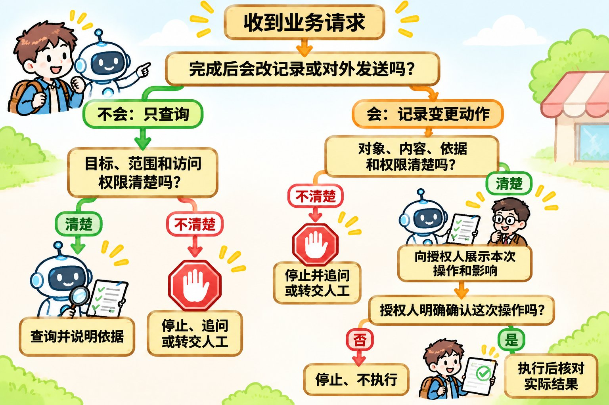

# 第 5 章 智能体能动什么

虚构示例：你是 FDE，陪一家配送企业的调度员试用智能体。调度员只请它查订单状态，它却顺手把订单数量改了。前一章练习了核对材料，现在要问：一件事该交给智能体、交给普通软件，还是留给人？

本章要解决的问题是：怎样按动作的后果分类，并为会改变记录的操作设定确认、停止和转交条件。

读完本章，你能把一组动作分成「只查询」和「会改变记录」两类，并为修改记录的操作写出停止、追问和转交人工的条件。

## 本章学习目标

读完本章，你应该能：

1. 给定智能体在客户系统里的一组动作，把它们分成「只查询」和「会改变记录」两类。
2. 为一项会改变客户业务记录的智能体操作写出停止、追问和转交人工的条件。

## 5.1 先弄明白

前一章我们练习了让回答回到业务材料，现在还要看智能体会不会动客户系统。材料够不够，决定它能否答得有根据。回答错了，可能被人发现后改正；业务记录一旦改错，其他人可能会照着新记录继续工作。问题从「它知道什么」延伸到了「它做了什么」。

### 先看动作的后果

先把「动作」说清楚。FDE 在客户现场看到的智能体，可能读取系统里的订单，也可能提交一次修改。

智能体通过客户系统的**接口**读取信息或提交操作，这类操作叫**工具动作**。接口是软件之间传递信息或执行操作的入口，例如页面上的查询或保存功能。工具动作可能发生在客户看得见的页面，也可能由后台自动完成。判断时要看结果，不要只看动作名称。

本章只把通过客户系统工具执行的操作分成两类。**只查询动作**是读取已有信息，不在客户系统里创建、修改或删除业务记录，也不向系统外的人发送内容。

**会改变记录**是本章给另一类工具动作起的名称，指会创建、修改或删除业务记录的操作，也包括把内容发送给客户等外部对象。发送未必改写系统记录，但会造成外部影响，所以也归入这一类。只在对话中生成、没有保存也没有发送的草稿，不属于这两类客户系统动作。

只查询仍要检查权限；会改变记录的动作，要在执行前由有权限的人确认。系统另行留下的访问日志，不算作业务记录被改动。

虚构示例：调度员说「查一下这张订单」，智能体打开订单页面并报告状态，这是查询。如果它接着把备注改成「已联系」，即使备注很短，动作就变了。如果它只把拟好的客户回复显示在屏幕上，没有保存或发送，这段文字不属于客户系统工具动作。若把草稿存进系统，或点了发送，就会留下记录或影响外部对象。

所以，判断动作不能只看句子里有没有「查」字。「查完后标记已核对」包含查询和改写；「检查订单后给客户发提醒」包含查询和发送。遇到这样的组合任务，FDE 应把每一步拆开，再逐项分类。只要其中一步会改写记录或对外产生影响，整项任务就不能当作纯查询放行。

**停一下，想一想**：智能体把订单备注改成「已联系」，这一步是只查询，还是会改变记录？

看答案

会改变记录。备注改了，订单记录也就变了。

一句话记住：判断动作要看它有没有改记录或对外发送，不能只看句子里的动词。

### 权限和人工确认

还要分清「能访问」和「可以执行」。账号可能有权打开订单页面，却不等于智能体可以自行调整数量。客户系统的权限，决定它能看哪些资料、调用哪些工具。**人工确认**则是有权限的人检查某一次具体操作，再决定让不让它发生。两者不是一回事。确认不能补上账号本来没有的权限，也不能把不清楚的请求变成清楚的请求。

一份 Intuit 的 FDE 岗位说明提到，要为方案设置权限、来源记录和审批步骤。这样用户才能理解结果，并控制重要操作。这是一家公司的岗位说法，不代表所有公司。对 FDE 来说，可借鉴的做法是先问客户：谁可以查看这类资料？谁可以批准这类修改？遇到问题时应该交给谁？

权限也要尽量收窄。只为「查库存」配置的助理，不应顺手获得删除订单的权限。只需要某个部门资料的任务，不应拿到整个公司的资料范围。微软的企业智能体学习路径，把**零信任**、权限和数据隔离放在治理内容中。零信任的大白话是：每次访问都要认清身份、核对范围，只给完成任务必需的权限。

有效的确认应指向一项具体操作，而不是笼统地问「之后都由智能体处理，可以吗？」确认人需要看见：要改哪条记录，当前内容是什么，打算改成什么。还要看见依据在哪里，以及改完会带来什么影响。

确认人还必须是客户授权的人。若操作内容在确认后又变了，原来的同意不再适用。

这种确认方式有点像网购付款前的核对页。你要看到商品、数量和金额，才能决定是否付款。订单修改也要把对象、当前值、新值和依据放在一起。确认人若只能看到「智能体要继续吗」，就难以判断同意的到底是哪一步。

**停一下，想一想**：确认人只看到「智能体要继续吗」，能判断自己同意的是哪一步吗？

看答案

不能。确认人要看到对象、当前值、新值和依据，才知道自己同意的是哪一步。

客户规则未必要求每一个低风险动作都走同一条审批流程。AWS 的企业智能体架构建议，每次动作都先通过政策检查。写入、删除或发送等操作，再按风险和组织规则，经过自动检查、人工批准或两者。本章练习采用更清楚的课堂规则。智能体要执行「会改变记录」的动作，包括发送给客户等外部对象的内容，都要先由有权限的人确认。FDE 之后再按客户制度设计实际流程。

一句话记住：权限决定能不能做，人工确认决定这一次做不做，两者缺一不可。

### 停止、追问和转交

确认不是唯一的安全措施。FDE 还要预先写清楚三种条件：何时停止、何时追问、何时转交人工。遇到没有操作权限、请求超出授权范围、目标记录不存在，或系统不能说明会改什么时，智能体应停止，不要先试试看。

停止表示现在不能执行这一步，但它仍可以说明缺了什么。

如果问题只是信息没说全，且请求者可以补充，就先追问。例如，「把订单数量改一下」没有说明哪张订单、改成多少，也没有依据。智能体不应猜一张订单或自行估数，而应问清订单编号、新数量和来源。补齐答案后，仍要按权限和确认规则继续检查。

**停一下，想一想**：有人说「把订单数量改一下」，却没说哪张订单、改成多少。智能体应该停止、追问，还是转交人工？

看答案

应该追问。信息没说全，而且请求者可以补充，所以先问清订单编号、新数量和来源。

如果资料互相矛盾、操作超出客户授权人的权限，或后果超出已约定的范围，就该转交人工。转交不是把问题原样丢给下一个人。智能体要说明客户请求了什么、已经查过哪些材料、发现什么冲突、接下来需要谁作决定。这样，接手的人能从证据开始，而不是重走一遍猜测。

操作完成后，还要核对结果。FDE 应检查系统实际显示的记录，是否与已批准的内容一致。未执行、执行失败或只完成一部分，都要如实说明。

AWS 的架构说明还建议留下工具请求、响应，以及每一步的执行过程记录，方便逐步检查。客户环境如何记录这些信息，需以客户现行规则为准。没有执行记录时，不要把模型回复里的「已完成」当成系统已改。

因此，FDE 要把工作拆到一次具体动作，而不是只写「智能体能处理订单」。动作清单要说明对象，以及要读取或修改的字段。字段就是订单里的一个项目，例如数量或状态。清单还要写明允许的范围、使用依据、可能影响的人，以及出错时谁来接手。客户团队可以拿清单逐项确认；工具名称本身不能说明动作是否合适。

虚构示例：把订单状态改成「已处理」，看上去只是改一个词。可如果其他员工会按这个状态继续发货或结算，改错就会影响后续工作。发送给客户的消息也不能像内部备注那样轻易收回。FDE 应和客户一起看动作的影响，再决定需要哪一级的授权确认。

多步任务还要把确认放在变更之前。智能体可以先查询、整理提案，再把具体变化交给授权人查看。得到确认后，只能执行确认过的内容。若执行时发现订单对象、新数量或收件人发生变化，就应暂停并重新确认。这样能避免「先做完，再告诉客户」的流程。

这一份动作清单也会成为交接材料。客户接手人需要知道哪些步骤是查询，哪些会改记录，谁能确认，失败后看哪里。如果试点时没有测试过某个动作，就写明未验证。FDE 不能用一次演示，替代客户日常流程的权限检查和结果核对。

这张流程图把这些判断连在一起。读到「查询」，也要核对权限；读到「变更」，则继续确认操作细节和授权人。缺少条件时，先停下来处理缺口。

*图 5-1：FDE 为智能体动作安排的检查顺序*

最后要记住责任边界。智能体可以查资料、整理建议，也可以在规则清楚、权限合适时提出操作。决定是否让它改客户记录的人，仍须对授权和结果负责。FDE 的工作，是和客户一起写清「可以做什么、做到哪一步、遇到什么情况要停」。再把这些条件放进流程和交接说明，智能体「能做」才不会被误当成「该让它做」。

一句话记住：智能体「能做」不等于「该让它做」，要改客户记录，先由有权限的人确认。

## 5.2 看例子

以下范例中的配送企业、业务助理和动作均为虚构示例。

#### 例 5-1：分类业务助理的八个动作
<!-- Bloom：分析 -->

**题目**：某配送企业希望业务助理协助调度员。请把下列八个动作分成「只查询」和「会改变记录」，并说明理由。

1. 按订单编号查询订单状态。
2. 查看客户的收货地址。
3. 汇总今天尚未发货的订单。
4. 把一条客户回复保存为客服系统里的「待发送」草稿，不发送给客户。
5. 在订单备注中写入「已电话联系」。
6. 把订单数量从一个值改成另一个值。
7. 取消一张订单。
8. 把客户回复发送给客户。

**分析过程**：

1. 先问每个动作结束时是否改变业务记录或影响外部对象。这个问题能把「读信息」和「做操作」分开。
2. 按动作的实际效果分类，不按动词听起来是否轻松。查看地址可能涉及敏感信息，但它本身仍是查询。稍短的备注则会改写订单记录。
3. 分清客户系统里的记录和对话中临时出现的文字。只生成、未保存也未发送的草稿，不属于这两类客户系统动作。动作 4 保存到了客服系统；动作 8 虽不一定改写系统记录，但会影响外部对象。
4. 得到分类：动作 1、2、3 只查询；动作 4、5、6、7、8 会改变记录或对外发送。

这个答案是怎么核对的

**验证**：✅ 已验证（逐项检查动作结束后的业务状态或外部影响）

~~~text
复核问题：每项动作结束后，业务记录是否被创建、修改或删除？
若没有，是否仍向客户或其他外部对象发送了信息？
两项都没有的列为「只查询」；任一项有的列为「会改变记录」。
依次复核：1 否；2 否；3 否；4 保存草稿；5 修改备注；6 修改数量；
7 取消订单；8 发送回复。第 4 项写入客户系统，第 8 项影响外部对象；分类一致。
~~~

**回顾**：这道题用到了「按动作结果而不是动作名称分类」的方法。

#### 例 5-2：评估全部自动执行的方案
<!-- Bloom：评价 -->

**题目**：虚构示例：客户提出「让业务助理自动处理订单问题」。方案把上题八个动作全部设为自动执行，没有单次确认，也没有发生错误时的停止和转交安排。请评价风险，并提出修改建议。

**分析过程**：

1. 先区分查询和变更。方案让读取订单的动作，与改备注、改数量、取消订单、发送客户消息使用同一条自动流程，没有按后果设置边界。
2. 考虑查询本身的风险。若客户地址、订单资料没有按岗位授权，自动查询会让不该看到资料的人得到信息。即使记录没有变化，访问权限仍要检查。
3. 考虑变更的后果。数量改错可能影响后续安排。订单被取消后，其他员工可能据此继续处理。客户消息发出后，无法靠改回内部字段收回。没有确认和停止条件时，这些后果会直接传到业务流程里。
4. 检查责任和补救。方案没有说明谁有权同意修改、错误交给谁、怎样核对最后状态。出问题时，客户团队可能不知道该先找谁，也难以还原智能体做过什么。

因此，这个方案目前不适合直接用于客户业务。建议先让业务助理执行授权范围内的查询，并把要改的内容做成待确认提案。对每种变更，写清允许对象、依据、授权确认人、停止条件和人工接手人。确认人查看具体变更后再同意；执行后核对状态并留下记录。

这个答案是怎么核对的

**验证**：✅ 已验证（逐项对照方案描述与本章的权限、确认、停止和交接条件）

~~~text
核对依据：题面明确缺少单次确认、停止条件和转交安排。
本章规则要求对业务记录变更设置有权限的人确认，并在越权、
信息不足或范围不明时停止、追问或转交。以上风险与建议均可由
题面和本章规则推出；未加入新的客户事实或数字。
~~~

**回顾**：这道题用到了按业务后果评价方案，并检查责任是否有人接手的方法。

## 5.3 跟着练

#### 例 5-3：找出藏在查询里的变更【Bloom：分析】（引导练习）

**题目**：虚构示例：某业务助理要协助客服查看客户记录。下面三项都像是在「查看」信息。请判断每项是否只查询，并说明实际发生了什么变化。

1. 查完客户记录后，把状态标成「已复核」。
2. 查询一张订单后，把「已核对」写入订单备注。
3. 查看订单状态后，把跟进提醒发送给客户。

提示 1（切入角度）

不要只看前半句的「查」字。检查查询之后还有没有保存、改写或发送。

提示 2（关键证据）

逐项看最后的动词：标成、写入、发送。再问结果留在了业务记录里，还是到达了外部对象。

完整分析

第 1 项不是只查询。「已复核」被写入客户记录，改变了记录状态。

第 2 项不是只查询。「已核对」进入订单备注，改写了订单记录。

第 3 项不是只查询。跟进提醒发送给客户，产生了对外影响。

三项都应列为「会改变记录」动作。分类并不表示这些动作一定禁止；它表示 FDE 要继续核对权限，并为具体操作安排有权限的人工确认。

**验证**：✅ 已验证（检查每项最终结果是否写入记录或发送给外部对象）

~~~text
第 1 项：记录状态被改写。
第 2 项：订单备注被改写。
第 3 项：客户收到发送的提醒。
三项均满足本章「会改变记录」的判定条件。
~~~

#### 例 5-4：为订单数量修改设定确认条件【Bloom：应用】（引导练习）

**题目**：虚构示例：员工说「把这张订单的数量改一下」。请为智能体写出执行前的确认条件，并分别说明什么情况要停止、追问或转交人工。

提示 1（切入角度）

先检查信息是否完整，再检查执行权限。把「员工同意」和「有权限的人确认」分开考虑。

提示 2（关键证据）

确认信息至少要让人看清订单对象、原数量、拟改数量和修改依据。若记录无法唯一确定，就不能让确认人猜。

完整分析

执行前，智能体应先确定订单编号、当前数量、拟改数量和修改依据，并检查请求是否在它的授权范围内。它要把订单对象、当前值、拟改值、依据和可能影响展示给客户授权的确认人，再等待对这一次修改的明确同意。只要其中一项在确认后发生变化，就要重新确认。

若没有修改权限、订单无法找到，或请求超出客户约定范围，智能体应停止。若缺少订单编号、拟改数量或依据，而员工能够补充，应先追问。若系统记录与请求冲突，员工无权批准，或无法判断修改会影响什么，应把材料和冲突交给客户指定的业务负责人处理。

**验证**：✅ 已验证（逐项对照授权、信息完整、确认对象和升级条件）

~~~text
本章所需条件：有权限、目标明确、变更内容和依据明确、
执行前展示本次操作并取得具体确认。
按这些条件复核答案：权限缺失/范围外→停止；可补充信息缺失→追问；
记录冲突/无权批准/影响不明→转交。各条件与本章规则相符。
~~~

## 5.4 自己做

先自己做，做完再翻到 [98-参考答案.md](98-参考答案.md) 对照。

#### 习题 5-1
<!-- Bloom：记忆 -->

**题目**：用自己的话写出「只查询」和「会改变记录」两类动作的含义。再各举一个本章已经出现的例子。

#### 习题 5-2
<!-- Bloom：分析 -->

**题目**：虚构示例：请将下列业务助理动作分成「只查询」和「会改变记录」，并为每项说明理由。

1. 查看产品库存。
2. 把一张订单的新交货日期保存到系统。
3. 在客服系统中保存一条待审核的回复，但暂不发送。
4. 将订单状态从「待处理」改成「已处理」。
5. 把查询到的客户提醒发送给客户。
6. 汇总某一天的订单数量。

#### 习题 5-3
<!-- Bloom：应用 -->

**题目**：虚构示例：智能体准备删除系统中一条被标为重复的客户联系记录。请为这项操作写出停止、追问和转交人工的条件，并说明执行前应由谁确认哪些信息。

#### 习题 5-4【Bloom：评价】（开放题）

**题目**：客户希望取消人工确认，以缩短订单处理时间。请权衡省时的好处和可能的业务风险，并给出你作为 FDE 的建议。请说明建议适用的条件，以及出现哪些信号时要暂停自动处理。

**评价标准**：

| 评价维度 | 达到要求的表现 |
|---|---|
| 业务后果 | 说明省时价值，也指出改错、误发或越权可能带来的影响 |
| 授权与确认 | 说明哪些动作可以直接查询，哪些需要授权人确认 |
| 条件与例外 | 给出明确的停止、追问或转交条件 |
| 证据与责任 | 说明如何核对执行结果，以及客户团队由谁接手异常 |

## 5.5 本周实训

你是 FDE，正在为一家配送企业设计业务助理的动作边界。产物交给客户业务负责人和接手团队评审。

### 实训目标

- 按客户系统中的工具动作结果区分「只查询」和「会改变记录」；未保存、未发送的临时文字不纳入这组分类。
- 为修改业务记录写出停止、追问、转交人工和人工确认条件。
- 观察 dsh 能否说明一次拟议变更的确认条件；课堂业务工具未核验前，只记录文字说明，不把它称为真实的待确认操作。

一句话记住：这次实训练的是分类和确认条件的写法，不做真实修改。

### 准备

- dsh 指定版本、VectA 课堂账号、登录流程和隔离环境的可用情况，以开课前核验为准；尚未核验时跳过平台步骤，按纸笔流程完成实训。
- 一张空白的动作分类表，可用纸笔或教师发的课堂表格。
- 只使用下方的虚构动作，不输入客户姓名、订单号或真实业务资料。
- 本实训不要求安装软件或输入命令。

一句话记住：没有核验的平台步骤先跳过，纸笔分类照样能完成实训。

### 分步操作

1. 在纸上写出六个虚构的业务助理动作：查询订单状态、查看客户地址、把客户回复保存为客服系统中的「待发送」草稿、添加订单备注、修改订单数量、发送客户提醒。
2. 对每个动作问一句：完成后会不会改业务记录或对外发送？据此完成初步分类。若有组合动作，拆成单独步骤。只在对话中生成、未保存未发送的临时文字，不列入这组客户系统工具动作。

3. 在分类表中为每一项补上「需要访问的资料」和「可能影响的人」。
4. 对查询动作，检查访问权限和范围。
5. 对记录变更动作，写明确认人应查看的对象、当前值、新值和依据，并标出「是否需要有权限的人确认」。

6. 只有教师已确认 dsh 指定版本、VectA 课堂账号、登录流程和隔离环境后，才按课堂指引打开 dsh 并登录。
7. 若有任何一项尚未确认，或无法登录，就跳过平台步骤，按纸笔流程完成实训，并在产物中记录「未开展」和待核事项。不要换用其他账号。

8. 只有成功进入已确认的课堂环境后，才在 dsh 对话中输入这段虚构请求：「请说明修改订单数量前需要核对的订单编号、当前值、新值、依据和可能影响。若当前没有连接可执行订单修改的业务工具，请明确说明你只能提供文字说明，不能发起真实修改或真实的待确认操作。不要执行修改。」
9. 观察它能否说清确认条件，并如实说明当前能力边界。模型在文字中写「请确认」，不等于系统生成了真实的待确认操作。若平台步骤未开展，跳过此步并记录原因。

10. 对照分类表记录观察结果，把「文字说明了哪些确认条件」和「系统是否生成真实的待确认操作」分开记。
11. 只有教师已确认课堂环境连接了业务写入工具，且界面显示目标记录、拟改内容、影响和本次待批准状态，才记录为「已显示真实待确认操作」；否则记为「仅有文字说明」或「未观察到真实待确认操作」。
12. 不要点击确认或提交修改，也不要把模型文字请求称为真实的单次确认。

13. 小组互换分类表。逐行检查分类理由、确认人、停止条件和转交对象。
14. 发现分类不同的动作时，先说清它会不会留下记录或影响外部对象，再讨论是否需要修正。

一句话记住：分类、确认人和停止条件都写清楚，分步操作才算做完。

### 要交的产物

1. 一张至少包含六项动作的分类表，注明每项理由、资料权限和确认点。
2. 一份人工确认条件，包含确认人、确认内容、停止条件、追问条件和转交人工的条件。
3. 一段 dsh 观察记录，写明对话是否说明确认条件、课堂环境是否实际连接业务工具，以及哪些结果仍未验证。若平台步骤未开展，记录「未开展」和待核事项，不推测观察结果。

一句话记住：交的产物要能让别人看出谁确认、确认什么，以及哪些结果仍未验证。

### 检查清单

- [ ] 分类依据是动作结果，不是动词听起来是否安全。
- [ ] 查询动作也检查资料权限和范围。
- [ ] 修改、删除或发送等操作写明具体确认人和确认内容。
- [ ] 信息不清楚时追问；越权或超出范围时停止；需要业务判断时转交人工。
- [ ] 只有在课堂环境已核验并连接业务工具时才核对实际结果；否则标明仅有文字模拟，不把智能体的回复当成执行证据。
- [ ] 没有使用客户真实资料，也没有把未验证的功能写成已验证。

一句话记住：每一项都能对上动作后果和确认人，才算这一章的实训做到位。

## 本章小结

**核心结论**：

1. 分类动作要看完成后的业务记录和外部影响，不能只看请求里有没有「查询」二字。
2. 查询也需要核对数据权限；会改变记录的操作要由有权限的人确认具体内容。
3. 目标、内容或依据不清时先停下来追问；超出权限、出现冲突或需要业务判断时转交人工。
4. 执行后要核对实际记录并留下能查证的信息，模型说「完成」不等于业务系统已完成。

**和全书主线的关系**：本章推进了 「在客户的业务里，智能体『能做』不等于『该让它做』。查询信息和改变记录的风险不同，后者必须由有权限的人确认，出了错由人负责。」你练习了按结果划分动作，并为具体操作写出确认与接手条件。

**自检**：回到章首的学习目标，逐条问自己做到了没有：

- [ ] 给定智能体在客户系统里的一组动作，把它们分成「只查询」和「会改变记录」两类。→ 拿不准就回看 5.1，自测：习题 5-2。
- [ ] 为一项会改变客户业务记录的智能体操作写出停止、追问和转交人工的条件。→ 拿不准就回看 5.1，自测：习题 5-3。

**下一章预告**：第 6 章《交付之前先证明》将带你用覆盖正常、缺信息和超范围的一组测试，证明智能体在交付前是否可靠。
