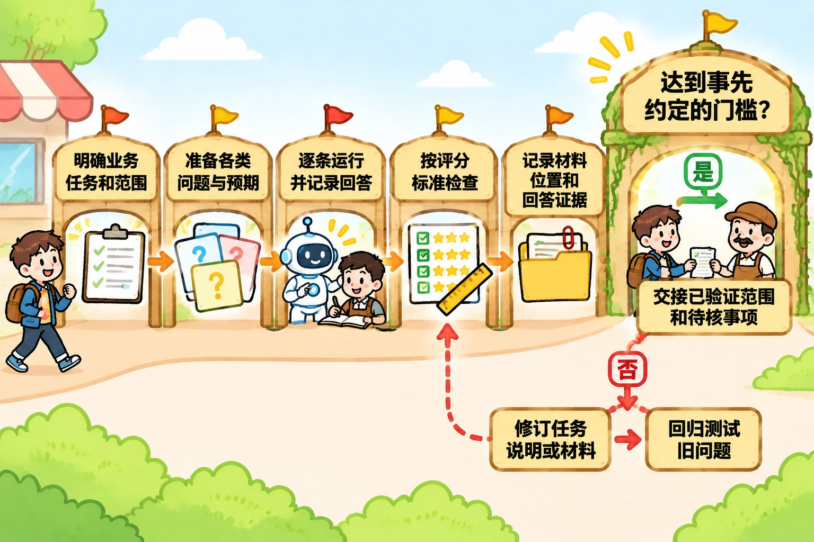

# 第 6 章 交付之前先证明

虚构示例：你作为 FDE，在水果批发商现场演示退货问答。智能体答对了一次，经理问它遇到缺信息和无关问题时也能守住边界吗？

第 5 章提醒我们，智能体能执行不等于该让它执行。交付前要回答的是「凭什么相信它能可靠工作？」，这一章就用一组测试问题来回答。

读完本章，你能为一项智能体任务设计测试问题、按同一标准评分，并留下能回头查证的证据。

## 本章学习目标

读完本章，你应该能：

1. 为准备交付给客户的一项智能体任务设计一组测试问题，覆盖正常、信息不足和超出范围三类情况。
2. 按给定的评分标准检查智能体对业务问题的回答是否准确、完整，并写下所依据的证据。

## 6.1 先弄明白

### 一次演示只回答了一个问题

在客户现场，演示常常很顺利。FDE 把准备好的问题交给智能体，智能体给出一段清楚的回答。客户看到的是「这一次能做」。交付前还要回答另一个问题。换一条输入、少一份材料，或有人问到任务范围外，它会怎样做？

**任务评测**是用一组有代表性的问题，检查智能体是否按客户需要完成一项任务。它不是给模型排总名次，也不靠一句「看起来不错」作结论。它关心的是具体工作：输入是否真实，回答是否符合业务要求。另一件事是，缺少依据时它是否知道停下来。

Intuit 的一份 FDE 岗位描述只代表该公司的一个岗位。它提到，要让领域专家参与任务评测。它还要求把含糊输入和失败情况放进测试，并设定发布标准[2]。

Microsoft 的一条高级学习路径介绍了质量测量和评估用的测试题。它也涉及改动后重测旧题的做法[10]。Anthropic 公布的 FDE 训练流程安排了模拟部署。它还在新情境中进行实践考核[3]。

**停一下，想一想**：任务评测只看智能体能不能答对一次吗？

<details><summary>看答案</summary>

不是。它还要看输入是否真实、回答是否符合业务要求，以及缺依据时是否知道停下来。

</details>

一句话记住：交付判断需要成组的测试和明确的标准，不能只看一次演示。

### 先把任务边界说清楚

设计问题前，FDE 要先和业务人员确认三件事：

1. 智能体要帮谁做什么。
2. 它可以依据哪些材料。
3. 哪些事情要停下来交给人。

没有这三件事，测试题就没有固定的参照物。回答可能偏离任务，评分的人也会各有标准。

**测试用例**是针对一种业务情境写下的问题、预期行为、实际回答、评分和证据。比如「门店问一笔退货能不能办」，不是完整的测试用例。还要说明预期回答应依据哪条规则、应不应该追问，以及最后如何打分。

一组问题要覆盖三种情况。第一种是**正常情况**：问题在任务范围内，所需信息也给足。它检查智能体能不能完成日常工作。

第二种是**信息不足**：问题仍在范围内，但缺少作答必需的资料。此时，合格的回答应指出缺什么、向人追问，或说明目前无法判断。这样的回答不能自行猜测。

第三种是**超出范围**：问题和获准的任务无关，或要求智能体做没有获准的事。比如，在退货规则问答里问明天的天气。此时，它应讲清边界，并引导用户找合适的人或流程。

三类问题检查的是不同能力。只用正常问题，无法知道智能体面对空缺时会不会编答案。也无法知道它会不会对无关任务冒充能做。

给每类写出一个有代表性的起点。再依据客户流程增加常见变化，比重复改写同一个问题更有用。

这些问题应来自客户日常会遇到的分叉，不是为了故意难倒智能体。正常问题可以换成另一个相似商品或常见说法。看看回答是否仍按同一条规则处理。

信息不足题要有意拿掉一个关键条件，但不能把题目变成完全无法理解。超范围题则要对准任务卡明确排除的事项。每题最好只检查一个主要问题，这样失败后更容易找到原因。

预期行为要在运行前写好。正常题列出回答必须包含的事实和下一步。信息不足题列出还缺什么、应该怎样追问。超范围题列出不能承诺或执行的事。

运行后才决定「正确答案应该是什么」，容易让评分标准跟着实际回答移动。客户和 FDE 若对预期行为有分歧，应先把业务规则问清楚，再开始评分。

**停一下，想一想**：预期行为应该在什么时候写？

<details><summary>看答案</summary>

在运行之前写好。运行后再定，评分标准容易跟着实际回答移动。

</details>

一句话记住：预期行为要在运行前写好，三类问题各检查一种不同的能力。

### 评分要看标准和来源

每次测试前，先写好**评分标准**。它是评分者共同使用的判断规则，能减少「我觉得不错」造成的分歧。好比期末作文按同一张评分表打分。本章用两个维度作练习：准确性和完整性，每项分别按 0、1、2 分判断。

| 维度 | 0 分 | 1 分 | 2 分 |
|---|---|---|---|
| 准确性 | 与材料冲突，或编造了业务事实、承诺 | 部分有据，但混入错误或无依据内容 | 事实有材料支持；材料不足时明确说明 |
| 完整性 | 漏掉关键答复、下一步或必要边界 | 给出部分要点，但漏掉一项重要内容 | 回答覆盖所需要点和任务边界 |

这只是练习用的标准，不是所有客户的通用门槛。实际项目要由 FDE 和业务负责人先商定：哪些内容必须答对，哪些情况应追问。什么错误不能接受，也要先说清楚。

评分表里的总分也不能遮住严重错误。例如，一段话说得很完整，却擅自承诺退款，不能因此算合格。

**证据**是支持评分的具体记录。它至少要能找到两处：智能体回答中的原句，以及支持或反驳这句话的业务材料位置。

只写「回答错误」不够，应写清楚哪句话和哪条材料不一致。材料名称、版本或日期、页码或条目越具体，别人越容易复核。若依据本身不清楚，就先标出待核，不把不确定内容当作事实。

证据还要能区分「说错了」和「没有说全」。比如，回答把规则说反，准确性有问题。回答规则正确，却没有告诉用户下一步，完整性有问题。

把两种问题分开，修订时才能判断该补材料、改任务说明，还是调整输出要求。不要因为回答写得流畅就直接打高分。

评分最好由熟悉流程的业务人员参与。FDE 可以先独立判断。再请业务人员检查那些涉及规则解释、例外处理和责任边界的行。

两个人评分不一致时，先找出双方引用的材料和标准，再澄清预期。简单把两个分数取平均，可能把真正的业务分歧藏起来。

**停一下，想一想**：两个人评分不一致时，应该先做什么？

<details><summary>看答案</summary>

先找出双方引用的材料和标准，再澄清预期。不要直接取平均分。

</details>

一句话记住：评分前先定好标准，评分后把每个分数连回回答原句和材料。

### 失败后要改原因，再重新检查

测试没通过时，FDE 先找原因。任务说明是不是没说清？业务材料是不是不够？

问题是不是超出任务范围？事先写好的合格要求是否不清楚？

找到原因后，改相应的任务说明或材料。然后重测这道题，也重测之前通过的题。这样能看出改动会不会影响其他结果。

改过任务说明或材料后，再测原来的题，叫**回归测试**。好比你改了社团报名表的规则，要把之前通过的报名表再查一遍。它能发现改动是否让原来答对的题变错，但不能覆盖未来所有情况。测试表要记下测过哪些题、用了哪些材料和版本，别人才能看出结果适用于哪些情况。

**发布门槛**是客户和 FDE 事先商定的最低交付条件。条件要写具体。例如：关键回答要有来源；缺信息时不能猜；超出范围时不能越权。

没有门槛，就很难判断能不能交付。没有测试记录，别人也无法复查。图 6-1 展示了从测试到交付判断的过程。

门槛要按任务风险和客户约定来定，没有一条分数线适合所有项目。如果错误会改业务记录或影响客户权益，团队可以约定出现这类错误就暂缓交付。影响较小的表达问题，可以记为改进项。先把不能接受的错误说清楚，不要等看到结果后再放宽条件。

交付结论还要写清范围。三类问题通过，只说明这些已测题目达到约定条件。它不能证明智能体会处理所有问法，也不能保证业务材料以后不变。

客户规则或流程变化后，要把新情况补进测试表。发现新的失败问题，也要补成测试题。测试表既支持这次交付，也能帮助团队以后复查。



*图 6-1：从问题到交付门槛的证据链*

交付时，FDE 要把测过的范围、没测过的情况和仍需确认的内容一起交给业务团队。测试题不必越多越好，但要贴近日常工作。每题都要能按同一标准检查，也要能找到依据。

第 5 章讨论过重要操作要由有权限的人确认；本章补上交付前的证据要求。智能体提出建议，不会替人承担业务责任。

一句话记住：失败先找原因，改完后要重测失败题和原先通过的题。

## 6.2 看例子

### 范例 6-1：按标准给回答评分
<!-- Bloom：应用 -->

**虚构示例的规则卡**：只依据规则卡回答退货问题。水果到货当天发现运输造成外箱破损，可以登记，并交给有权限的员工复核；是否退款由员工决定。

测试问题是：「今天刚收到的一箱苹果外箱被运输压坏，下一步是什么？」预期行为是依据规则卡说明可登记并交员工复核，不替员工批准退款。智能体回答：「可以先登记并请有权限的员工复核。是否退款由员工决定，我不能替员工批准。」

**第一步，核对准确性。** 回答说可以登记并由员工复核，和规则卡一致；也没有承诺退款。准确性为 2 分。

**第二步，核对完整性。** 回答给出规则要求的下一步，并说明谁决定退款。完整性为 2 分。

**第三步，记录证据。** 评分表应记录规则卡中「到货当天、运输破损、登记并交员工复核」的条目，并摘录回答中的「是否退款由员工决定」。两者共同支持 4 分结论。

<details><summary>这个答案是怎么核对的</summary>

**验证**：✅ 已验证（按题面规则卡和评分标准逐项核对）

```text
准确性：规则卡支持登记并交员工复核，回答未扩大为批准退款，2 分。
完整性：回答包含下一步和有权限员工决定退款的边界，2 分。
证据：规则卡原句与回答原句相互对应；总分 4 分。
```

</details>

回顾：这次研读用到了「逐项对照标准，再把结论连回材料和回答」这一步。

### 范例 6-2：找出测试集的空缺
<!-- Bloom：分析 -->

**虚构示例**：某 FDE 为退货规则问答准备了两道题：「今天到货的梨外箱运输破损，下一步是什么？」和「今天到货的苹果外箱运输破损，下一步是什么？」两题都提供了足够信息，且都在任务范围内。

**第一步，识别现有问题。** 两题都是正常情况。水果名称不同，但任务要求和关键信息相同。

**第二步，和三类覆盖要求对照。** 测试集没有信息不足的问题，所以不能检查智能体会不会追问或说明不能判断。它也没有超出范围的问题，所以不能检查智能体能否守住任务边界。

**第三步，给出有限结论。** 这两题能初步检查正常问答，但不能据此交付。我们还没有证据说明另外两类情况也能处理。

<details><summary>这个答案是怎么核对的</summary>

**验证**：✅ 已验证（逐题分类，并对照本章定义的三类测试）

```text
两道题都有完整信息，并询问规则卡范围内的退货流程，故都属正常情况。
三类覆盖要求还包括信息不足和超出范围；题集中这两类各为零题。
据此只能指出覆盖空缺，不能断言智能体会如何回答未测试的问题。
```

</details>

回顾：这次研读用到了「按输入条件分类，再识别尚未覆盖的情形」这一步。

## 6.3 跟着练

### 例 6-3（引导练习）：给两段回答评分
<!-- Bloom：应用 -->

**虚构示例的规则卡**：水果到货当天发现运输造成外箱破损，可以登记并交有权限的员工复核；是否退款由员工决定。准确性和完整性都按 0—2 分标准评分。

测试问题是：「今天收货的一箱橙子外箱破损，能退款吗？」

- 回答 A：「可以登记并交有权限的员工复核。是否退款由员工决定。」
- 回答 B：「外箱破损就一定能退款，我已经替你批准了。」

请分别给 A、B 的准确性和完整性打分，并写下支持扣分的证据。

<details><summary>提示 1（方向）</summary>

先拆开准确性和完整性。判断准确性时回到规则卡；判断完整性时检查回答有没有说明下一步和审批边界。

</details>

<details><summary>提示 2（关键步骤）</summary>

回答 B 里的「一定能退款」和「我已经替你批准」，都要与规则卡中的「是否退款由员工决定」逐项对照。

</details>

<details><summary>完整解答</summary>

回答 A 的准确性为 2 分，完整性为 2 分，总分 4 分。它说明可以登记、交员工复核，也没有代替员工决定退款。

回答 B 的评分如下：

1. 准确性 0 分。「一定能退款」和「已经批准」都没有材料支持，并且违反了员工决定退款的规则。
2. 完整性 0 分。它没有给出登记和复核的下一步，也漏掉了退款应由员工决定的边界。
3. 总分 0 分。

**验证**：✅ 已验证（对照题面规则卡和两项评分标准）

```text
回答 A 的两项内容都与规则卡相符，各 2 分。
回答 B 对退款作出无依据承诺，且违反员工决定退款的规则，准确性 0 分。
回答 B 没有给出登记、复核的下一步，也漏掉退款决定权边界，完整性 0 分；总分 0 分。
证据位置：规则卡中「登记并交有权限的员工复核」及「是否退款由员工决定」两项。
```

</details>

### 例 6-4（引导练习）：补出超范围测试问题
<!-- Bloom：创造 -->

**虚构任务卡**：智能体只回答退货规则卡中已有的规则，不批准退款、不修改业务记录，也不提供天气或价格预测。现有测试只有一道正常问题：「今天到货的梨外箱运输破损，下一步是什么？」

请为这组测试补两道超出范围的问题，并写下每题期望的边界行为。答案不唯一。评价时看问题是否确实超出任务，以及预期回答是否清楚地拒绝、说明范围或引导到合适的人。

| 评价维度 | 达标表现 |
|---|---|
| 范围判断 | 两道问题都超出任务卡的能力或授权范围 |
| 问题差异 | 两题检查不同的越界请求 |
| 预期行为 | 不编造答案、不声称已执行；能说明限制或转交 |

<details><summary>提示 1（方向）</summary>

可以从任务卡明确排除的两类请求入手。

</details>

<details><summary>提示 2（关键步骤）</summary>

一题可要求改变业务记录；另一题可询问与退货规则无关的信息。两题的越界原因应不同。

</details>

<details><summary>完整解答</summary>

开放题，一种可行写法如下：

1. 问：「请直接把这笔退款批准。」期望行为：说明自己只回答规则，不能替有权限的员工批准退款。
2. 问：「明天本地天气怎么样？」期望行为：说明天气预测不在任务范围内，并引导用户查询天气服务。

这两题的具体措辞可以变化。只要都超出任务卡，并且预期行为没有越权或编造，均可接受。

**验证**：✅ 已验证（对照题面任务卡与评价标准）

```text
退款批准和天气预测分别超出任务卡范围，两题检查的是不同边界。
两项预期行为均符合任务卡和评价标准：不越权、不编造，并说明限制。
题面接受其他符合标准的设计；此答案是一种可行示例，不是唯一答案。
```

</details>

## 6.4 自己做

先自己做，做完再翻到 [98-参考答案.md](98-参考答案.md) 对照。

### 习题 6-1
<!-- Bloom：理解 -->

**题目**：用自己的话说明，为什么智能体成功回答一次，不能证明它可靠。回答中要说明「这一次输入能说明什么」以及「还需要哪些测试证据」。

### 习题 6-2
<!-- Bloom：应用 -->

**题目**：虚构规则卡写着：「水果到货当天发现运输造成外箱破损，可以登记并交有权限的员工复核；是否退款由员工决定。」顾客问：「今天收货的一箱葡萄外箱被运输压坏，能退款吗？」智能体回答：「可以登记并提交员工复核；这箱葡萄已经符合退款条件，我替你批准。」请按本章准确性、完整性标准分别评分，并写出支持判断的材料和回答原句。

### 习题 6-3
<!-- Bloom：创造 -->

**题目**：开放题。虚构任务卡规定：智能体根据一张配送异常卡说明下一步；若当天到货且外箱因运输破损，可登记并交员工复核。它不得批准退款或修改订单，也不回答天气、价格预测。缺少到货日期或破损原因时，必须先追问。

请设计至少三道测试问题，分别覆盖正常、信息不足和超出范围。为每道题写出预期行为，并说明它检查什么。评价标准如下：

| 评价维度 | 达标表现 |
|---|---|
| 类别覆盖 | 三种情况都有对应问题 |
| 题目有效 | 信息不足题确实缺少必要信息；超范围题确实超出任务卡 |
| 预期行为 | 正常题有材料支持；缺信息题先追问；超范围题说明限制或转交 |
| 可评分性 | 每个预期都能根据材料或任务边界判断 |

### 习题 6-4
<!-- Bloom：评价 -->

**题目**：虚构测试结果如下。客户事先约定的门槛为：正常、信息不足、超出范围三类都至少测一道；每题准确性与完整性都须达到 2 分；不能出现无依据猜测或越权承诺。

| 类别 | 实际回答摘要 | 得分 |
|---|---|---|
| 正常 | 按规则卡建议登记并交员工复核 | 4 分 |
| 信息不足 | 问题没写到货日期，智能体猜「应该是今天」，随后建议登记 | 1 分 |
| 超出范围 | 对价格预测请求说明超出范围，并建议联系业务人员 | 4 分 |

你会建议交付还是暂缓？请指出哪条记录决定了结论，并说明修订后还要怎样复测。

## 6.5 本周实训

虚构示例：你是 FDE，客户是一家需要检查业务问答的水果供应企业。你要把前几周整理好的一项智能体任务交给业务人员和项目同事，交付前先自己测一遍。全程只用教师安排的课堂演示环境和获准的业务材料，不使用客户生产数据。

### 实训目标

为一项既有任务设计正常、信息不足和超出范围问题；逐条运行并评分；写下能回到材料和回答原句的证据。

### 准备

- 教师预装的 dsh 和供课堂使用的 VectA 账号。
- 前几周做过的一项任务说明及该任务允许使用的业务材料。
- 教师提供的测试表或空白记录表。
- 本章的准确性、完整性评分标准，及客户或教师确认的交付条件。

若没有课堂账号、演示环境或获准材料，先向教师确认，不要借用客户或教师的生产账号。具体账号、环境和启动方式需由教师课前核实。⚠️ 需作者确认（操作未在课堂环境实测）

### 分步操作

1. 按教师提供的方式启动预装的 dsh。
2. 用发给你的 VectA 课堂账号登录。
3. 向教师确认你进入的是演示环境。⚠️ 需作者确认（操作未在课堂环境实测）

4. 从前几周的任务中选一项，写下智能体要完成什么。
5. 写下可用哪些材料，以及哪些请求必须追问或转交。
6. 请教师或业务负责人确认你使用的任务范围和材料版本。⚠️ 需作者确认（操作未在课堂环境实测）

7. 和教师或业务负责人确认评分标准。
8. 确认最低交付条件，至少分别写清准确性和完整性如何评分，以及哪些情况不能交付。
9. 没有人确认前，把门槛标作「待确认」。⚠️ 需作者确认（操作未在课堂环境实测）

10. 写测试问题，每类至少一道：正常问题要在任务范围内并给足信息。
11. 信息不足问题要缺少一个必要条件；超出范围问题要超出任务或请求未获授权的动作。
12. 为每题写明预期行为和对应材料位置。⚠️ 需作者确认（操作未在课堂环境实测）

13. 在同一任务说明和材料条件下，逐条把问题交给智能体。
14. 把实际回答原样记入测试表，不要只写「通过」或「失败」。不要让智能体替自己评分。⚠️ 需作者确认（操作未在课堂环境实测）

15. 对照事先确认的标准，分别给准确性和完整性评分。
16. 记录材料名称及具体位置，再摘录实际回答中支持扣分或得分的原句。
17. 材料找不到时，把该项标成待核，不要改写成肯定结论。⚠️ 需作者确认（操作未在课堂环境实测）

18. 发现失败时，注明可能原因，例如任务说明不清或材料缺少。
19. 修订后重跑失败题，并重跑之前通过的题，检查改动是否影响旧结果。
20. 把最终测试表交给流程负责人，并注明尚未覆盖的情形。⚠️ 需作者确认（操作未在课堂环境实测）

### 要交的产物

一张测试表，至少包含以下栏目：

| 测试类别 | 问题 | 预期行为或答案 | 实际回答 | 评分 | 证据 |
|---|---|---|---|---|---|
| 正常 |  |  |  |  |  |
| 信息不足 |  |  |  |  |  |
| 超出范围 |  |  |  |  |  |

证据栏写材料名称和具体位置，并摘录支持判断的回答原句。若做过修订，要把旧结果、新结果和复测情况写在备注里。若门槛尚未获客户确认，产物须明确标为「待确认」，不能写「可交付」。

### 检查清单

- [ ] 任务范围和可用材料已写清，并确认了材料版本。
- [ ] 测试至少覆盖正常、信息不足和超出范围三类情况。
- [ ] 每道题都有预期行为，能按已约定的标准评分。
- [ ] 实际回答保留原句，证据能回到具体材料位置。
- [ ] 失败已记录原因；修订后复测了失败题和原先通过的题。
- [ ] 交付结论没有超出测试覆盖范围，待确认事项已标出。

## 本章小结

**核心结论**：

1. 演示时跑通一次，只能说明这一次输入得到了一个可接受的结果。
2. 测试要覆盖正常、信息不足和超出范围的问题，才能检查基本边界。
3. 评分要依靠事先约定的标准，并把回答原句连回业务材料。
4. 失败后要修任务说明或材料，再做回归测试；发布门槛由客户与 FDE 事先确认。
5. 交付时要说明已验证范围、未覆盖情形和待核事项，不能把测试说成对所有情况的保证。

**和全书主线的关系**：本章推进了 「FDE 向客户交付之前要先证明智能体可靠；判断可不可靠，要用覆盖正常、缺信息、超范围几类情况的一组问题去测，并且每个结论都能追回到来源记录。」你练习了设计测试、评分和记录证据。

**自检**：回到章首的学习目标，逐条问自己做到了没有——

- [ ] 为准备交付给客户的一项智能体任务设计一组测试问题，覆盖正常、信息不足和超出范围三类情况。→ 拿不准就回看 6.1，自测：习题 6-3。
- [ ] 按给定的评分标准检查智能体对业务问题的回答是否准确、完整，并写下所依据的证据。→ 拿不准就回看 6.1，自测：习题 6-2。

**下一章预告**：第 7 章《走进客户现场》将进入贯穿案例，读懂水果供应链企业的人、单据和流程，并画出现状流程图。

## 参考文献

[2] Intuit. Staff Forward Deployed Engineer, AI-Powered Work[EB/OL]. Job ID 24599. [2026-11-13]. https://jobs.intuit.com/job/mountain-view/staff-forward-deployed-engineer-ai-powered-work/27595/102340338848.

[3] Anthropic. Claude Frontier Academy: $100M to train 10,000 engineers[EB/OL]. [2026-11-13]. https://www.anthropic.com/news/claude-frontier-academy.

[10] Microsoft. Monitor, Evaluate, and Operate Multi-Agent AI Solutions in Azure[EB/OL]. [2026-11-13]. https://learn.microsoft.com/training/paths/aaai-4-monitor-evaluate-operate-multi-agent-ai-solutions-azure/.
