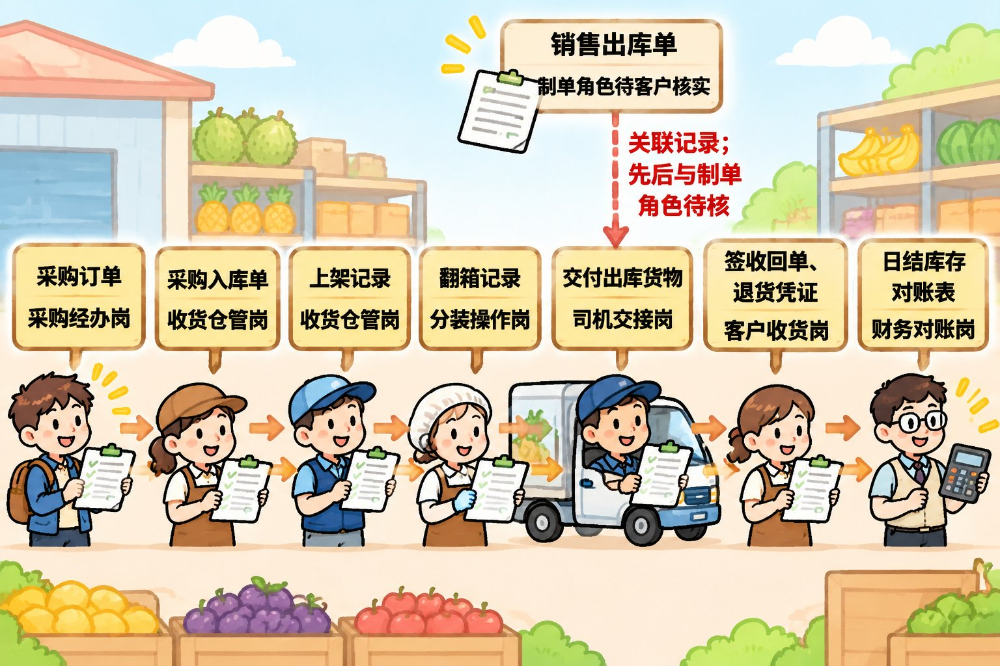
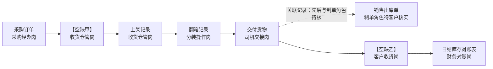

# 第 7 章 走进客户现场

贯穿案例中的水果要从供应商进入仓库。之后按渠道重新分装，再按订单送往商超，最后还要核对实收、退货和结算。假设客户说「库存数量对不上」，作为 FDE，你不能只凭这句笼统的话就开始做工具。面对陌生行业，应该先做什么？

本章解决的问题是：怎样读懂一条陌生的业务，再把它画成供客户核实的图。「库存数量对不上」是课堂假设问题，不是访谈原话，也不代表客户每天都遇到。

读完本章，你应该能画出一条从采购到对账的业务流程，并标出每一步的角色和单据。

## 本章学习目标

读完本章，你应该能：

1. 画出水果供应链中采购入库、分装、出库和对账的先后关系，并标出每一步的角色和单据。

## 7.1 先弄明白

### 7.1.1 先看一笔业务怎样走完

假设客户对你说：「我们想把对账做快一点。」这句话说明了一个愿望，却没有说明工作卡在哪里。可能是单据找不到，也可能是数量单位没对上，或是退货还没核实。若没看实际工作，就容易把猜测当成问题。

FDE 要先观察一笔业务从哪里开始、怎样结束。**业务流程**，就是一项工作从开始到完成所经过的一连串动作。动作之间有先后关系。水果供应链的一笔业务，可能从采购开始。它会经过入库、重新分装和出库，最后到签收、退货和对账。

「可能」两个字很重要。不同客户、不同商品的做法会有差别。FDE 要先记下**现场**（工作实际发生的地方）里的步骤，再问每一步为什么这样做。不能因为自己熟悉网购，就认定客户的采购和发货也按网购的办法进行。

观察时，可以从一张单据或一批货开始。问清这件事由什么触发，谁先做，留下了什么记录，下一步交给谁。如果对方用「仓库处理」概括一段工作，可以继续问：谁收货、谁登记、谁确认数量？这样的问题不是挑错，而是把一句概括拆成看得见的动作。

FDE 也要区分「别人说的流程」和「眼前做的流程」。员工可能把常见做法说得很顺，但忙起来会先打电话、后补单；也可能有一张表长期没人更新。访谈能告诉你人们怎样理解工作。观察和单据能帮你检查工作实际怎样发生。三种信息要放在一起看，不能让其中一种替代另外两种。

公开资料也把现场观察放在 FDE 工作中。OpenAI 的介绍提到先了解业务和流程，再定义希望达到的结果。[1]

Intuit 的两份岗位说明提到观察员工决策、交接、最初记录业务的软件和例外。它们还提到在真实使用中迭代。[2][11]

这些是企业介绍和岗位说明，只描述各自的实践。它们不代表所有公司都采用同一流程。

**停一下，想一想**：客户说「我们想把对账做快一点」，这句话能直接告诉你问题卡在哪里吗？

<details><summary>看答案</summary>

不能。它说出了一个愿望，却没有说明工作卡在哪一步，所以还要去现场观察。

</details>

一句话记住：先看一笔业务实际怎样走完，再谈要解决什么。

### 7.1.2 先认清做事的人

同一件工作里，常有几个人接力。**业务角色**，就是一个人在这条业务链上承担的工作责任。它说的是「负责哪件事」，不是某个员工的真实姓名，也不一定等于他的职位名称。像社团活动里有人收报名费、有人登记名单，这就是两个业务角色。

贯穿案例的课堂链条里，采购经办岗建采购订单。收货仓管岗核收来货、登记入库并安排上架。分装操作岗记录投入和实点产出（实际点数得出的产出）。

货物离开仓库时，司机交接岗负责交付并带回凭证。客户收货岗登记签收和退回的货物。财务对账岗把采购、库存、出库、回单和差异连起来。

这些是岗位标签，按课堂数据集设定，不是客户员工名单。现实里，一个人可能同时做几项工作，也可能多人轮班做同一项工作。画流程时，要写下每一步由哪个角色负责。如果一个角色代做另一个角色的事，要先确认这是不是固定做法。

还要问清谁做、谁提供信息、谁确认结果。有时司机把货交给客户收货岗，财务之后才看到回单。司机、收货人和财务都出现在流程里，但他们负责的不是同一步。把这些人统统写成「业务人员」，就看不出交接发生在哪里，也不知道缺了信息该找谁。

这一点对 FDE 很实用。客户问「为什么签收数对不上」时，你不应只找财务看表。还要确认是谁点货、谁填回单，以及回单怎样交到财务手里。角色图不是组织架构图；它只留下和这条业务有关的人与责任。

一句话记住：业务角色回答的是谁负责哪件事，不是某个人的名字。

### 7.1.3 再认清单据和系统里的记录

**业务单据**，是一张能说明业务发生了什么的凭证。例如采购入库单、翻箱记录或签收回单。单据可能是纸张，也可能是电子文件。

**系统记录**，是软件里保存、之后可以查询的一条业务数据。两者可能写着相同的单号和数量。但一个是业务凭证，一个是系统中的数据，不能直接当成同一件东西。

拿到一张单据，FDE 要看它记录哪一步、由谁提供、和哪张前序单据相连。若系统里的数量和凭证不一样，就要回到凭证核对。若只看到一个系统记录，却没看到原始凭证，也要把这一点写清楚。不能说自己已经核实过原件。

单号可以帮助连接记录，却不能替代检查。日期相同，不代表两条记录属于同一批货。**批次**，就是一批可以单独追踪的货。不同批次即使商品名称相同，也可能来自不同采购。FDE 应沿着单据上的关联关系找来源，不能只按日期或商品名把记录拼在一起。

以下是课堂合成示例，不是客户实账。**账套**，就是单独保存业务记录的一套数据空间。课堂若通过平台查看，只能进入与客户生产数据隔离的虚拟账套。⚠️ 需作者确认（开课前核对为演示账套实际记录）

**翻箱**，就是把原包装的货重新分成新的包装规格。课堂数据写着：虚构供应商·启明的采购订单是 40 箱。采购入库单记录 +40 箱，上架记录仍是 40 箱。

上架只是换了仓内位置，不能再算一次入库。之后，翻箱记录 FX-2026-0801-01 记入 −40 箱、产出 +456 盒。

按每箱 12 盒计算，40 箱理论上是 480 盒；记录中的实点产出是 456 盒。两者差 24 盒，但数据没有说明差额原因。FDE 不能顺手把 24 盒写成报损，因为目前没有凭证支持这个说法。

这组记录还提醒你，不要把同一天的业务随意连在一起。另一张入库单记有 +6 箱，属于独立批次，不是这 40 箱的来源。要判断它和翻箱有没有关系，应看来源单据与批次。

**停一下，想一想**：另一张入库单和这批翻箱货是同一天的业务。能不能因此把它算作这批货的来源？

<details><summary>看答案</summary>

不能。它属于独立批次，不是这批货的来源。要看来源单据与批次，只看日期会连错。

</details>

一句话记住：单据说明业务发生了什么，系统记录说明软件里存了什么，两者要分开核对。

### 7.1.4 把先后关系画出来

**现状流程图**，就是把客户现在实际怎样做画出来的一张图。它不是理想方案，也不是系统功能图。图上要让人看出每一步的先后、由谁负责、用哪张单据。还要看出货物或信息在哪里交给下一位。

FDE 可以先画主链，再补上旁边的例外。下面是课堂复原图，不是已经核实的客户现状。访谈摘要提及业务动作；角色和具体单据来自课堂合成数据集。销售出库单与司机交付动作分开标注，制单角色及两者先后待客户核实。



*图 7-1：按访谈摘要和课堂合成记录整理的课堂复原图；虚线表示待核的单据关联*

画图时，箭头表示先后或交接，不表示中间一定没有等待。每个流程方框最好写动词、角色和单据。例如，「收货」比「仓库」清楚。「收货仓管岗，采购入库单」比单写「入库」更容易核对。虚线单据框是关联旁注，不是一个流程步骤。

有些节点要分开画。采购入库与上架是两个动作，但上架不重复增加库存。分装与销售出库也不是一回事：前者改变包装规格，后者把货交给客户。若把动作都挤进一个「仓库处理」方框，后面的人就看不见数量和责任在哪里变化。

一句话记住：画流程图时，每一步的先后、角色和单据都要看得见。

### 7.1.5 标出交接和等待的地方

**交接点**，是工作从一个角色交到另一个角色、同时需要传递货物或信息的位置。比如司机把货交给客户收货岗，随后回单还要到财务手里。FDE 画出交接点，才能继续问清凭证谁保管、什么时候转交、接收方如何确认。

**等待点**，是某一步做完后，下一步要等人或等材料才能继续的位置。图上可以标出「等客户回单」或「等财务核对」，但要区分看到的事实和自己的推测。如果没有记录起止时间，FDE 可以说「时间字段缺失，等待多久无法判断」。不能直接说「客户拖了两天」。

课堂数据中，签收回单有 199 盒签收，但实际签收时间字段为空。出库单上客户名称写「星穗生活馆」，而数据集中的客户标准名称是「星穗优选」。这两个名称是否是同一客户尚未确认。

客退差异草稿写 12，单位空白。已确认的退货入库单记录 +1 盒，草稿也没有过账（还没有正式记入账目）。它们都是需要核对的线索，不能直接并入库存或写成确定结论。

画完后，FDE 应把「已确认」「记录不一致」和「还不知道」分开标。比如，订单、入库、翻箱和出库的先后可能已经有凭证支撑。客户别名是否对应同一客户，还需要业务人员确认。把未知项留在图旁边，比用猜测填满图更有用。

一张好图能让客户和 FDE 指着同一处讨论：「这张回单是谁拿到的？」「退货单对应哪次出库？」「差异还没确认时，谁能继续处理？」这些问题会把笼统抱怨变成可以调查的具体步骤。下一步才是判断哪件事值得解决，以及应该由人、普通软件还是智能体来做。

**停一下，想一想**：司机把货交给客户收货岗，这一步算不算交接点？

<details><summary>看答案</summary>

算。工作从司机交接岗交到客户收货岗，同时交接的是货物。

</details>

一句话记住：交接点和等待点都要标在图上，看到的事实和自己的推测要分开写。

一张好图能让客户和 FDE 指着同一处讨论：「这张回单是谁拿到的？」「退货单对应哪次出库？」「差异还没确认时，谁能继续处理？」这些问题会把笼统抱怨变成可以调查的具体步骤。下一步才是判断哪件事值得解决，以及应该由人、普通软件还是智能体来做。

## 7.2 看例子

### 例 7-1：读出一段工作描述中的先后顺序
<!-- Bloom：理解 -->

**材料**（访谈摘要转述，不是逐字引语）：访谈提及，一家水果供应链企业采购不同供应商的水果，收货后按仓库和批次记录；进入加工环节后，会按渠道需要重新分装，再按订单送往商超；之后核对商超实收、退货、报损和结算。本题只整理摘要提到的主链。具体角色和单据由课堂合成记录补充，仍待客户核实。

**题目**：用自己的话说明货物从采购到对账经过哪几步。指出材料能支持的流程，也指出它没有交代什么。

**分析示范**：

1. 圈出材料里的动作词：采购、收货、记录、重新分装、送货、核对。这些都是流程步骤。先找动作，是因为「水果」「商超」这类名词不能单独说明先后。
2. 按材料的连接词排列步骤。采购之后是收货和记录，加工环节接着重新分装，然后按订单送货。送货之后核对实收、退货、报损和结算。这样就得到一条从进货到对账的主链。
3. 区分流程大意和操作细节。材料支持上述先后关系，也说明了核对哪些业务结果。但它没有逐项说出谁填写每张单据、每一步需要多长时间。不能把这些没写的内容补成事实。

**结论**：按访谈摘要，主链可概括为采购、收货、重新分装、按订单送货，再核对签收、差异和结算。要画成客户现状图，还要通过客户角色和单据确认每一步。

**回顾**：这段分析用到了按动作词提取步骤、再按连接关系排列的阅读方法。

<details><summary>这个答案是怎么核对的</summary>

**验证**：✅ 已验证（核对贯穿案例的流程描述）

```text
核验记录：
依据：案例访谈摘要所述的采购、收货、重新分装、送货、核对实收与结算主链。
结论依赖的内容：摘要明确提及的业务动作及其先后关系。
核对结果：答案与摘要相符；摘要未说明具体角色、单据和等待时间，分析中将它们列为待核，没有用课堂合成记录冒充客户实况。
```

</details>

### 例 7-2：分清角色、单据和系统记录
<!-- Bloom：分析 -->

**材料**：课堂记录列出一张采购入库单：单号为课堂-RK-20260801-01，日期为 2026-08-01，数量为 +40 箱，关联采购订单课堂-CG-20260801-01。收货仓管岗负责核收来货和登记入库。若这些字段已经录入软件，软件中可查询的那条数据就是系统记录。

**题目**：把材料中的「收货仓管岗」「采购入库单」和「软件中可查询的那条数据」分别归为业务角色、业务单据或系统记录。说明三者为什么不能互相替代。

**分析示范**：

1. 找出谁承担工作。「收货仓管岗」回答的是谁核收来货、登记入库，所以它是业务角色。
2. 找出说明业务发生什么的凭证。「采购入库单」说明收到什么、数量多少，所以它是业务单据。题目没有说纸质原件一定存在，因此不能把这条记录直接叫作纸质原件。
3. 找出软件里保存的可查询数据。单号、日期、数量和前序采购订单若被录入软件，就构成相应的系统记录。这里描述的是「若已录入」的情形，不表示课堂演示账套已经核验过这条记录。

三者互相关联但作用不同。角色做事，单据留下业务依据，系统记录让信息可以在软件里查询和关联。若把单据当成系统记录，就会误以为纸面凭证已录入。若把角色当成单据，就不知道实际依据在哪里。

**回顾**：这次研读用到了按「谁负责、凭什么证明、软件保存什么」拆分材料的方法。

<details><summary>这个答案是怎么核对的</summary>

**验证**：✅ 已验证（核对术语定义与课堂数据字段）

```text
核验记录：
依据：本章对业务角色、业务单据、系统记录的定义；课堂数据中采购入库单的单号、日期、数量及其关联订单。
结论依赖的内容：收货仓管岗承担收货责任；采购入库单是业务凭证；软件中的可查询数据才是系统记录。
核对结果：材料没有声称纸质原件存在，也没有声称所列课堂记录已经从 VectA 实际导出。
```

</details>

## 7.3 跟着练

### 例 7-3（引导练习）：补全流程图中缺少的步骤
<!-- Bloom：理解 -->

**材料**：本题用两类课堂材料复原主链。访谈摘要提及采购、收货、按渠道重新分装、按订单送货和后续对账；课堂合成数据集补入采购订单、入库单、上架、翻箱、销售出库、签收、退货和财务对账等具体记录。角色标签也来自课堂合成设定，不是客户岗位核实结果。

下图有两个步骤空缺。每个方框都要写出动作和对应单据。



实线箭头表示课堂复原的业务顺序；虚线只表示单据有关联，不表示先后。销售出库单由谁制作，材料没有说明。

**题目**：补全甲、乙两步，并写出每步应关联的单据。

<details><summary>提示 1（方向）</summary>

甲发生在货物到仓时；乙发生在客户收到货物之后。

</details>

<details><summary>提示 2（关键线索）</summary>

甲要记录采购货物实际进入仓库；乙要记录客户签收数量和可能退回的货物。

</details>

<details><summary>完整分析</summary>

1. 甲是采购入库，由收货仓管岗核收，关联采购入库单。它在上架之前，因为货物先要确认已进入仓库，再记录放到哪个位置。
2. 乙是客户签收和退货登记，由客户收货岗负责，关联客户签收回单。若有退货，还要关联售后退货入库单。它在出库之后，因为客户只有收到货物后才能清点和签收。
3. 两步按采购、入库、上架、重新分装、出库、签收或退货、财务对账的先后排列。题面没有提供签收时刻，所以不能补写等待时长。

</details>

<details><summary>这个答案是怎么核对的</summary>

**验证**：✅ 已验证（核对课堂数据集中的单据名称与关联顺序）

```text
核验记录：
依据：课堂合成数据集中的采购订单、采购入库单、上架记录、翻箱记录、销售出库单、签收回单、退货入库单和日结库存对账表，以及访谈摘要提及的业务主链。
结论依赖的内容：数据集支持甲、乙对应的单据和先后位置；司机交付与销售出库单有关联，但没有给出制单角色或两者先后。
核对结果：空缺甲、乙均能在数据集中找到依据；图中把交付动作和销售出库单分开，虚线仅表示关联，未把课堂角色写成客户已核实岗位，也未补出签收时间。
```

</details>

### 例 7-4（引导练习）：在流程中找交接点和待确认的时间
<!-- Bloom：分析 -->

**材料**：课堂销售出库单课堂-XS-20260802-01记录 −200 盒，单上客户写「星穗生活馆」。关联的签收回单课堂-SH-20260802-01记录 199 盒签收，但「实际签收时间」为空；关联的退货入库单课堂-TH-20260802-01记录 +1 盒，客户名称写「星穗优选」。数据集中的客户标准名称为「星穗优选」。

**题目**：在这三张记录的流程里，指出一个交接点和一个时间方面的等待或记录缺口。说明你能确认什么、还不能确认什么。

<details><summary>提示 1（方向）</summary>

先找货物从一个角色交给另一个角色的位置，再看哪项时间证据缺失。

</details>

<details><summary>提示 2（关键线索）</summary>

200 盒发出、199 盒签收、1 盒退回；签收时间字段没有填写。

</details>

<details><summary>完整分析</summary>

1. 交接点在司机交接岗把货物交给客户收货岗时。出库单、签收回单和退货入库单分别留下发货、签收和退回的记录。
2. 时间方面的缺口是签收回单没有实际签收时间。你能确认数据记录了 199 盒签收和 1 盒退回。不能确认客户何时签收，也不能计算从出库到签收等了多久。
3. 两个客户名称写法不同，需要客户或业务人员确认后才能关联。标准名称是「星穗优选」，出库单写「星穗生活馆」。数据没有证明二者是同一客户，因此不应把名称差异当作已经解决。

</details>

<details><summary>这个答案是怎么核对的</summary>

**验证**：✅ 已验证（核对课堂数据集的签收、退货与名称字段）

```text
核验记录：
依据：本章课堂数据中的销售出库、签收回单、退货入库和客户标准名称记录。
结论依赖的内容：出库 200 盒、签收 199 盒、退货 1 盒；实际签收时间为空；两个名称的关系未确认。
核对结果：数量和字段与数据集一致；分析没有推断具体签收时间或等待时长。
```

</details>

## 7.4 自己做

先自己做，做完再翻到 [98-参考答案.md](98-参考答案.md) 对照。

### 习题 7-1
<!-- Bloom：记忆 -->

**题目**：列举课堂链条中的业务角色和主要单据。角色至少列出 4 个；单据中至少写出采购、入库、重新分装、出库、签收或退货、对账各环节的一项。

### 习题 7-2
<!-- Bloom：理解 -->

**题目**：画一张流程图，说明采购入库、上架、重新分装、出库、签收或退货、对账的先后关系。每一步标出负责角色和对应单据，并在交接处画箭头。

### 习题 7-3
<!-- Bloom：分析 -->

**题目**：根据例 7-1 的访谈摘要转述和本章课堂合成记录，比较访谈提及的业务主链与记录中的主链。指出至少两项记录层面的缺口或待核内容，并将每项标为「访谈提及」「课堂合成记录」或「待客户核实」。说明为什么不能把课堂合成数据当成客户实账。

### 习题 7-4
<!-- Bloom：分析】【开放题 -->

**题目**：从课堂记录中选出你认为最容易出错的一个环节，说明你选择它的证据、可能造成的后果，以及你会找谁或查哪张单据继续核实。可以选择不同环节；结论必须和数据相符。

**评价标准**：

| 维度 | 有证据的分析 | 有方向的回答 | 需要补充 |
|---|---|---|---|
| 证据定位 | 指出具体单据、字段或数量 | 指出相关环节，但证据不够具体 | 没有依据课堂记录 |
| 风险说明 | 解释记录错误会怎样影响后续签收、库存或对账 | 说出可能影响，未连到后续步骤 | 只说「会出错」，没有说明影响 |
| 后续核实 | 指出可询问的角色或应查的关联单据 | 提到要核实，但对象不清楚 | 把未确认的信息直接当成事实 |

## 7.5 本周实训

本实训安排为 2 课时。你是 FDE，正在帮助一家水果供应链企业梳理一笔从采购到对账的业务。这属于决定问题和技术方案之前的现场发现工作。

### 实训目标

使用课堂合成记录复原一笔业务的入库、重新分装和出库过程，对照访谈摘要，画出带有角色、单据和交接点的课堂复原图，供客户业务、收货和财务人员核对。图区分访谈提及、合成记录和待客户核实项；对记录不全或互相不一致的地方，不自行补齐。

### 准备

若课堂使用平台，只能进入与客户生产数据隔离的虚拟账套。本次练习使用教师发放的课堂数据集，不依赖平台登录或账套查询。课堂只使用虚拟记录，不用客户生产数据、真实单据或员工信息。

每组准备纸张或电子表格，留出「步骤、角色、单据、关联记录、交接点、信息来源/状态、待核事项」七栏。访谈摘要使用本章例 7-1 的转述材料。

### 分步操作

1. 读取教师发放的课堂数据集摘录。
2. 确认材料注明它是课堂合成示例，不是客户实账，也不是演示账套导出的记录。
3. 本次练习不要求登录 dsh 或 VectA（课堂使用的实验平台）。若开课前改为平台实训，作者须先确认学员账号、账套隔离和查询流程已在目标课堂环境验证；未验证时继续使用数据集。⚠️ 需作者确认（dsh/VectA 登录、隔离账套和查询流程未在课堂环境实测；开课前验证）
4. 按课堂数据集中的关联来源，依次抄录采购订单、采购入库、上架、翻箱、销售出库、签收、退货和对账记录。
5. 原样抄下单号、日期、数量、单位和来源。材料没有的字段写「未提供」或「待核」，不要自己补填。
6. 对照例 7-1 的访谈摘要，把能对应上的步骤依次写进观察表。
7. 把摘要提及的动作标为「访谈提及」，把单号、数量和角色标签标为「课堂合成记录」。
8. 访谈摘要没有说明的角色或单据，标为「待客户核实」。
9. 将观察表中的主链画成课堂复原图。每个框写一个动作和已知角色、单据；未提供的角色不要猜。
10. 在角色更换的位置标出交接点。
11. 实线箭头表示课堂材料支持的业务顺序。单据关联或制单责任待核时，用虚线和旁注标出。
12. 两组交换流程图，逐项检查单据能否连回上一环节。确认不了的关系保留为待核。另一组发现的问题写成批注，由原组决定是否修改。

### 要交的产物

每组提交一张课堂复原图和一张待核清单。复原图作为「现状流程图」初稿，供客户核实；确认前不能称为已核实的客户现状。图中要包括采购入库、上架、重新分装、出库、签收或退货、对账；标清角色、单据、交接点和信息来源。待核清单至少写出记录中没有的信息，并说明需要询问哪个角色或查看哪张凭证。

### 检查清单

- [ ] 流程从采购开始，按单据关联顺序连接，没有只按日期拼接。
- [ ] 每个步骤都标了负责角色和单据。
- [ ] 入库和上架分开表示，没有把上架重复计算成一次入库。
- [ ] 重新分装、销售出库、客户签收和退货各自分开。
- [ ] 同日另一批 +6 箱没有并入 40 箱的来源批次。
- [ ] 24 盒差额没有擅自记作报损。
- [ ] 签收时间空白、客户名称不同、退货草稿单位空白等项目留作待核。
- [ ] 图上区分了访谈提及、课堂合成记录和待客户核实项；虚线没有被当作业务先后。
- [ ] 没有把课堂合成示例称为客户实账。

## 本章小结

**核心结论**：

1. FDE 要从一笔实际工作开始，核对客户说法、角色和单据。
2. 业务角色说明谁负责；单据说明业务发生了什么；系统记录说明软件里保存了什么。
3. 现状流程图要标出先后、角色、单据和交接点；缺少的证据要留作待核。
4. 日期相同不代表同一批业务；货物数量的差额也不能在没有凭证时擅自命名为损耗。

**和全书主线的关系**：本章推进了 「客户嘴上说的需求常常不是真正的问题，要去看实际的人、单据和流程，才能找到值得解决的那一个。」你练习把笼统说法拆成可观察、可核对的步骤。

**自检**：回到章首的学习目标，逐条问自己做到了没有：

- [ ] 画出水果供应链中采购入库、分装、出库和对账的先后关系，并标出每一步的角色和单据。→ 拿不准就回看 7.1，自测：习题 7-2。

**下一章预告**：第 8 章《找对问题》将练习从客户的抱怨里找出值得解决的问题，并写成现状、目标和不处理的范围。

## 参考文献

[1] OPENAI. Forward deployed engineering for enterprise AI[EB/OL]. [2026-11-13]. https://openai.com/business/forward-deployed-engineering/.

[2] INTUIT. Staff Forward Deployed Engineer, AI-Powered Work[EB/OL]. Job ID 24599. [2026-11-13]. https://jobs.intuit.com/job/mountain-view/staff-forward-deployed-engineer-ai-powered-work/27595/102340338848.

[11] INTUIT. Principal Forward Deployed Engineer—AI-Native Invoicing[EB/OL]. Job ID 23519. [2026-11-13]. https://jobs.intuit.com/job/-/-/27595/100183029744.

