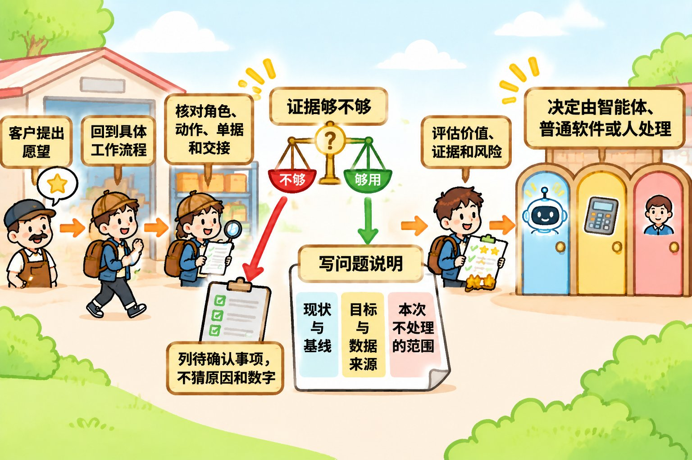

# 第 8 章 找对问题

上一章画出流程图后，你回到水果供应链企业的对账现场。财务人员要在纸单、表格和系统回单（系统生成的确认单）之间找对应记录，也会打电话核对。要是客户只说「给我做个 AI」，FDE 该先做什么？

这一章要解决的问题是：怎样从现场证据里找出具体不便，并把它写成一页**问题说明**。问题说明是一页工作交代，写清现状、目标、数据来源和本次不处理的范围。

读完本章，你能写出这样一页问题说明，并判断一项任务该交给智能体、普通软件还是人。

## 本章学习目标

读完本章，你应该能够：

1. 判断给定的客户业务任务适合交给智能体、普通软件还是人，并说明理由。
2. 把流程中的一个不便之处写成问题说明，列出现状、目标和本次不处理的范围。

## 8.1 先弄明白

### 从客户说法回到现场

流程图让你看见工作怎样一步步完成，但一张图还没有替你选出该改哪一步。FDE 要接着问：哪一个动作最让人费力，证据在哪里，改好以后又要看到什么变化？如果先选技术，后面容易围着工具找问题。先找问题，才知道方案有没有用。

客户会用熟悉的办法表达愿望。有时他说「想要 AI」，有时他说「报表能不能快一点」。这些话有价值，因为它们告诉你客户想改变什么；但它们通常没有说明谁在做哪项工作、当前怎么做、哪里受阻。

本章所说的**不便**，指实际工作中反复出现的一处麻烦。它让人多花力气，容易出错，或难以继续。比如，小店每次对账都要翻好几个本子，这就是一处不便。它不是客户说得最生气的那句话，也不是 FDE 替客户猜出的损失。你要把不便放回具体流程，再用人、单据和记录核对。

先把客户的工具愿望放回对账现场。材料显示，财务要在工厂单、系统回单和日表之间找对应记录。你可以和业务负责人从这一步开始核对：有哪些记录，名称不一致时谁来判断它们的关系。

两份 Intuit 的 FDE 岗位说明可以作参考。一份提到观察实际工作、挑选有价值的问题，并记录可衡量的起点和成功标准。 另一份强调跟随真实开票流程，依据实际使用反馈调整方案。 这是两份 Intuit 岗位资料的描述，不代表所有公司的岗位要求。

访谈摘要也提到，财务要从工厂单、系统回单和日表中找对应记录。过程中会重复抄录和电话核对。同一往来单位（和客户或供应商有业务往来的单位）也可能有不同写法。这些事实能提示你从「对账时如何找到同一笔业务」开始追问。它们还不能说明问题发生多频繁、耗时多少，或哪种方案最合适。

**停一下，想一想**：客户说「想要 AI」，这句话告诉了你什么？还缺什么？

<details><summary>看答案</summary>

它告诉你客户想改变什么。但它没说谁在做哪项工作、当前怎么做、哪里受阻。

</details>

一句话记住：先找到客户愿望背后的具体工作，再谈工具。

### 把事实、未知和猜测分开

现场发现不是替客户下结论。先沿着一笔工作往下看：谁接到什么材料，接着做了哪些动作。再看在哪一步要作判断，最后留下什么记录。遇到例外时，再问当事人如何处理，以及他用什么凭证确认结果。

访谈回答是线索，单据和系统记录是另一种证据。两者对不上时，不要挑一个顺眼的说法当事实。你要把材料分成三栏：**已知事实**，指已经用单据或记录核对过的内容；**待确认事项**，指还没有证据的内容；**假设**，指你自己提出、尚未核实的解释。三栏能防止一种常见错误：把「可能因为很忙」写成「员工经常延误」。

问题说明里写到的数字也要能找到来源。没有时间记录，就不能估计每天花多久；没有例外次数，就不能说错误很频繁。你可以把缺口列出来，请客户提供记录或安排观察。先承认不知道，后续才有机会补上证据。

**停一下，想一想**：访谈里有人说「可能因为很忙，所以员工常延误」。这句话该放进哪一栏？

<details><summary>看答案</summary>

「可能因为很忙」是尚未核实的解释，放进「假设」。「员工常延误」如果没有记录支持，只能先放进「待确认事项」。

</details>

一句话记住：材料能证明的写进已知事实。证明不了的，写成待确认事项或假设，别混在一起。

### 用一页问题说明固定范围

问题说明只有一页。它不是技术方案，也不是客户所有愿望的清单。FDE、业务负责人和开发同伴可以据此讨论下一步，不必各自猜测任务。

第一栏写现状。说明涉及的角色、流程步骤、单据或系统记录，以及已经核对出的不便。描述时尽量写可观察的动作，例如「财务从三类来源查找对应项」。少写「效率很低」这类没有参照的评价。

如果要比较改进前后，需要先记下一个**基线**。它指开始解决问题之前，实际工作处于什么状态。好比减肥前先量一次体重，之后才知道有没有变化。基线可以是经确认的数量、时间、错误记录，也可以先是一个可核对的现象。没有证据时，把需要补采的内容写清楚，不要自己填一个数字。

第二栏写目标。目标要描述完成后，用户能看到或做到什么。比如，核对人员能从结果追回所依据的单据；缺少关键信息时，系统能把缺项交给人确认。目标可以分阶段，但不能只写「使用 AI」或「提升效率」。如果客户希望量化改善，就要约定量什么、从哪里取数、由谁确认。

目标还要和现状对得上。若现状说的是名称不一致，目标就应描述怎样确认并关联名称。若现状说的是字段缺失，目标就应描述怎样发现缺项、继续核实。目标不能突然跳到另一个结果，也不能预先承诺一定由智能体完成。

开工前，FDE 和业务负责人还要谈妥怎样判断目标做到。已经有稳定记录时，可以选一个能从记录中复查的指标；没有可靠数据时，先约定记录方法和复核人。这样，后续试做（先在小范围实际用一用）才有共同的检查尺度。否则只能各自凭感觉说「好像快了」。

第三栏写数据来源。列出实际查看过的流程说明、单据或系统记录，以及尚未取得的材料。每一项关键事实都要能回到来源。这样开发同伴知道根据什么做，客户也能发现你是否把不同批次或不同往来对象接错。

第四栏写「本次不处理的范围」。它说明本轮暂时不做什么。原因可能是证据不够、前提条件还没备好、风险太高，或不属于眼前问题。它不是说这些事永远不做，而是避免试做时偷偷扩大任务。例如，若客户身份还没核清，本轮可以提出名称冲突供人确认，但不自动合并两种名称。

把四栏连起来读一次。现状是证据，目标是要观察的变化。数据来源让证据可追溯，本次不处理的范围限定这一轮要负的责任。目标如果看不出和现状的关系，问题可能选偏了。来源不足，就先补证据。范围写不清，下一步就容易变成不断加需求。

**停一下，想一想**：开工前没有任何记录，能不能先在问题说明里填一个基线数字？

<details><summary>看答案</summary>

不能。应该写清需要补采的材料，不自己填数字。

</details>

一句话记住：问题说明的四栏要能互相对上，缺哪一栏就先补哪一栏。

### 先决定哪个问题值得做

客户通常不只遇到一处不便。先选哪一处，不能只看哪件事最容易展示。FDE 可以比较四方面：影响、频率、证据和前提条件。影响指它对业务工作的影响。频率指它多久发生一次。证据指现有记录够不够用。前提指解决它还依赖什么条件。若某项没有记录，就把它当作未知，不用猜测的数字给问题打分。

还要看错误的后果。若只是查询建议，人还能逐条复核。若要改动库存、客户档案或对外发送内容，错误就会直接影响业务。问题说明应指出这轮希望系统做哪一步、哪一步必须由有权限的人确认。风险高但依据不足的任务，可能应先补资料或缩小范围。

优先顺序也要能解释给客户。你可以这样解释：「先做这一项，因为它影响哪些工作、已有哪份证据、还缺哪项准备。」而不是只说它容易开发。若两项都值得做，就记录当前选择和未选项，客户补充影响或依赖后再调整。排序是一项需要依据的业务判断，不是永远不变的分数。

资料里若有多个问题，可以先选一个能用现有证据检查的部分，写清它与更大目标的关系。范围小不一定价值高；范围大也不一定马上可做。选题要同时说明为什么值得做，以及现在还缺什么条件。

一句话记住：选问题要同时看影响、证据和前提，证据不够时先补证据，不用猜测的数字排序。

### 问题定下来，再选择由谁处理

不是每项工作都该交给智能体。普通软件按固定规则重复处理，适合步骤稳定、条件明确的任务，比如按规则自动算好的成绩表。智能体可以整理材料，也可以列出写法相近的候选记录，供人核对。它不能只凭名称相似，就认定两条记录属于同一个客户。需要承担责任、依据不足或后果重大的判断，应留给有权限的人确认。

有时三者会接力。软件先按明确条件筛出记录。智能体把材料整理成容易读的摘要。人再判断是否属于同一笔业务，并批准后续动作。FDE 要把每一步分开，不能因为智能体能生成答案，就让它替人承担业务责任。

当客户说「做个 AI」时，问题说明先写业务任务，不急着写工具名称。问题已经清楚后，再判断哪一步适合自动处理，哪一步需要人参与。若还不能说明现状、目标和范围，最好的下一步往往是继续观察或找凭证。



*图 8-1：从客户愿望回到证据，再形成问题说明和初步分工。*

一句话记住：先定问题，再分工。规则固定的交给软件，责任重大的留给人。

## 8.2 看例子

本节用课堂数据集（老师为练习准备的一组虚构记录）练写法。下面的例子是课堂合成示例，不是客户实账。

#### 例 8-1：从「给我做个 AI」找出待解决的问题
<!-- Bloom：分析 -->

**题目**：客户说「给我做个 AI」。这句话是本题设定的说法，不是贯穿案例的客户原话。结合贯穿案例中关于财务对账的访谈摘要，分析这句话背后值得进一步核实的问题是什么。

**分析**：

1. 先判断这句话属于什么。它指出了客户想到的工具，却没有说明具体任务，所以暂时不能直接当成问题说明。
2. 再找工作对象。访谈摘要谈到财务需要从工厂单、客户系统回单和日表里寻找对应记录。这让我们把注意力放到对账的查找和核对步骤。
3. 接着找可观察的不便。摘要提到重复抄录、电话核对，以及往来单位写法可能不同。因此，一个候选问题是：财务人员需要跨来源识别同一业务记录，材料写法不一致时还要人工追问。
4. 然后检查证据边界。摘要没有给出发生次数、耗时、错误数量，也没有证明每次名称不同都指向同一单位。不能据此宣称节省了多少时间，也不能让系统自动合并名称。
5. 最后写出下一步。FDE 应抽取相关单据，观察核对动作，并向财务确认哪些记录可视为同一业务。若事实成立，再约定目标；是否使用智能体，之后按任务和风险决定。

**暂拟问题说明**：现状是财务需要从多种来源查找并核对业务记录，写法不一致时会继续追问；目标是让相关记录能依据可追溯材料供财务核对，缺少依据的匹配仍交给人确认；来源是贯穿案例的访谈摘要，具体记录和频率待查；本次不处理自动合并单位名称和自动记账。

<details><summary>这个答案是怎么核对的</summary>

**验证**：✅ 已验证（对照贯穿案例访谈摘要及本章的问题说明步骤）

```text
核验记录：贯穿案例档案第四节记载重复抄录、电话核对、多个来源及名称写法不一；原文未给出次数、时长或错误数量。本章 8.1 要求先核对现场问题，再写目标和范围。分析保留了已知事实，并将身份匹配和技术选型留作待核事项。
```

</details>

回顾：这段分析用到了问题拆解中的「核对来源、划出未知、再写有边界的结论」这一步。

#### 例 8-2：把缺少签收时间写成问题说明
<!-- Bloom：应用 -->

**题目**：课堂材料中，`课堂-SH-20260802-01` 记有 199 盒签收，但「实际签收时间」字段为空。请照着范例写出现状、目标、数据来源和本次不处理的范围。

**分析**：

1. 先照录记录现状。已知的是签收数量和空缺字段；单据日期不能替代实际签收时间。
2. 再描述目标状态。对账人员应能看出这个字段缺失，并知道需要依据哪份凭证补核，而不是读者自行推定时间。
3. 明确来源。当前依据是该签收回单；要确认实际时间，还需找到客户签收记录或其他经客户认可的凭证。
4. 最后设定边界。不根据制单日期填入签收时间，不据此判断送货是否迟到，也不归责给司机或客户。

**问题说明**：

- **现状**：签收回单 `课堂-SH-20260802-01` 记录 199 盒签收，但实际签收时间为空。现有材料不能说明货物实际何时签收。
- **目标**：财务核对时能识别时间缺项，并依据经确认的凭证补充或保留待核状态。
- **数据来源**：课堂数据集中的签收回单 `课堂-SH-20260802-01`；实际签收时间的凭证尚未提供。
- **本次不处理的范围**：不以单据日期代替实际签收时间，不据此推断迟到，也不自动填写空白字段。

<details><summary>这个答案是怎么核对的</summary>

**验证**：✅ 已验证（逐项核对课堂数据集中的签收回单字段）

```text
核验记录：课堂数据集第三节明确记载 199 盒签收，且「实际签收时间」字段故意留空。数据集第五节说明不得仅凭制单日期认定签收时点。问题说明没有补造时间、原因或迟到结论。
```

</details>

回顾：这段分析用到了把已知现状、目标、来源和范围分别落栏的方法。

## 8.3 跟着练

#### 例 8-3：把退货抱怨改写成问题说明【Bloom：应用】（引导练习）

**题目**：下列是根据课堂材料编写的练习抱怨，不是客户原话：「退货入库记了 1 盒，差异草稿又写 12，还没有单位。能不能让 AI 自动对上并补好？」请改写成问题说明，至少写出现状、目标、数据来源和本次不处理的范围。

<details><summary>提示 1（方向）</summary>

先分开看两件事：材料能证明什么，抱怨中提出了什么方案。

</details>

<details><summary>提示 2（关键证据）</summary>

退货入库单记录 `+1 盒`；关联的客退差异草稿写 `12`，单位空白，而且草稿尚未过账（还没正式记入账目）。目标应保留这项差异供人核实。

</details>

<details><summary>完整分析</summary>

**问题说明**：

- **现状**：退货入库单 `课堂-TH-20260802-01` 记录 `+1 盒`；关联的未过账草稿 `课堂-DZ草稿-20260803-01` 记录 `12`，单位空白。现有材料没有证明两者数量相同。
- **目标**：核对人员能查看两张记录及其来源；单位和数量未确认前，差异保留为待核，不并入库存余额。
- **数据来源**：课堂数据集中的退货入库单 `课堂-TH-20260802-01` 与客退差异草稿 `课堂-DZ草稿-20260803-01`。
- **本次不处理的范围**：不推定 `12` 的单位，不自动改写退货数量，不把未过账草稿纳入余额，也不自动过账。

**验证**：✅ 已验证（逐项核对课堂数据集中的退货单与未过账草稿）

```text
核验记录：课堂数据集第三节给出退货入库 +1 盒、关联草稿 12 且单位空白，并明确草稿未过账。第五节说明该差异待核，不得直接并入库存。目标和范围没有把未知单位补成事实。
```

</details>

#### 例 8-4：在两个问题中决定先核实哪一个【Bloom：评价】（引导练习）

**题目**：现在只能先查一项。A：主数据（系统里统一登记的标准资料）中客户名为「星穗优选」，但部分往来单据写「星穗生活馆」，是否同一客户尚未确认。B：签收回单的实际签收时间字段为空。若本轮先要避免把业务记录归错对象，你会先核实哪一项？说明依据，也说明另一项为何仍要保留。

<details><summary>提示 1（方向）</summary>

先看每项问题影响哪一种判断，再区分「记录已经证明」和「可能发生的后果」。

</details>

<details><summary>提示 2（关键证据）</summary>

客户别名关系明确标为未确认；签收时间字段为空，但材料没有给出实际签收时刻。不要把潜在风险写成已发生的错误。

</details>

<details><summary>完整分析</summary>

**判断**：若本轮目标是避免把记录归到错误的客户名下，我会先核实 A。理由如下：

1. 数据集明确说两种名称是否为同一客户尚未确认。在确认前合并往来记录没有依据。
2. 下一步可先找客户主数据，或请经授权的人员确认名称关系。
3. B 也要处理。但现有证据只说明签收时间字段为空，不能证明实际签收时刻或是否迟到。先把它记作待核，不用单据日期填空。
4. 课堂材料没有提供问题发生频率或业务损失。因此这只是按本题指定目标作出的顺序，不代表 A 在所有业务影响上更大。

**验证**：✅ 已验证（核对课堂数据集第五节的名称与签收时间待核项）

```text
核验记录：课堂数据集第二、三节给出客户主数据名称及往来单据别名；第五节明确两者是否同一客户尚未确认。签收回单的实际签收时间留空，且数据集说明不能据制单日期认定时点。题目指定优先目标为避免错归客户，因此先核实名称关系；结论未声称实际已经错配。
```

</details>

## 8.4 自己做

先自己做，做完再翻到 [98-参考答案.md](98-参考答案.md) 对照。

#### 习题 8-1
<!-- Bloom：理解 -->

**题目**：用自己的话解释，为什么不能把「做一个智能体」直接当作问题说明。你的回答要说明问题说明先记录什么，以及先写工具名称会漏掉什么。

#### 习题 8-2
<!-- Bloom：应用 -->

**题目**：题面已有两条记录：客户主数据写「星穗优选」，销售出库单 `课堂-XS-20260802-01` 写「星穗生活馆」。材料未确认两种名称是否指同一客户。请为这一不便写一份问题说明，包含现状、目标、数据来源和本次不处理的范围。

#### 习题 8-3
<!-- Bloom：分析 -->

**题目**：阅读以下材料，把内容分成「已知事实」「待确认事项」「本次不处理的范围」三类。不要增加材料没有的人物、原因或数字。

- 退货入库单 `课堂-TH-20260802-01` 记录 `+1 盒`。
- 关联的客退差异草稿 `课堂-DZ草稿-20260803-01` 记录 `12`，单位空白，且未过账。
- 草稿上的客户名为「星穗生活馆」，客户主数据为「星穗优选」，是否同一客户尚未确认。

#### 习题 8-4
<!-- Bloom：评价 -->

**开放题**：材料给出三个待处理问题：签收回单 `课堂-SH-20260802-01` 的实际签收时间为空；客户主数据与部分往来单据的名称不一致且关系未确认；同日另有 `+6 箱` 入库，属于独立的 `虚构批次-L03`，不能只按日期接到 `虚构批次-L01` 的链条。选一个你认为最值得先解决的问题并为选择辩护。说明下一步由智能体、普通软件还是人处理，以及为什么。不要编造频率、工时或损失数据。

**评价标准**：

| 观察维度 | 达成表现 | 尚未达成表现 |
|---|---|---|
| 证据边界 | 指出对应记录中的已知事实，并把尚未确认的关系或时间留作未知。 | 把待确认事项写成已发生的错误，或增加材料未提供的事实。 |
| 优先理由 | 用问题可能影响的业务判断和现有证据解释先后，不虚构频率或损失。 | 只说「更重要」或用没有来源的数字排序。 |
| 任务分工 | 说明由智能体、普通软件或人先做哪一步，并让高风险判断保留人工确认。 | 只按工具是否新颖选择，未说明任务边界或责任。 |

## 8.5 本周实训

你是一名 FDE，正在帮助一家水果供应链企业梳理对账工作。你要从上周的流程图里选一处不便，写一页问题说明，交给业务负责人和开发同伴讨论下一步。

### 实训目标

- 把现状、目标、数据来源和本次不处理的范围写清楚。
- 区分已知事实、待确认事项和自己的假设。

### 准备

- 上周完成的流程图。
- 可选：教师准备的 dsh（DeepSeek Harness，本书的实训平台）网页界面，以及课堂 VectA 账号（VectA 是本书实训用的业务平台）。只有教师确认课堂登录流程可用后才使用。
- 可选：教师确认可用的隔离演示账套（与客户生产数据分开的练习数据），以及本次可查的虚拟记录。
- 纸、笔，或一页问题说明的空白模板，纸质或电子文档都可以。即使课堂环境不可用，也可完成本实训。

开课前，教师要核对课堂账号、隔离账套和记录查找路径。还要核对 dsh 和 VectA 的登录与对话流程。上述流程尚未完成课堂验证。教师开始前还要说明账套与客户生产数据隔离，并指出允许查看的记录范围。

如果账号或隔离环境不可用，不要借用教师账号，也不要尝试进入客户账套。直接按分步操作中的纸面替代流程完成一页问题说明。

### 分步操作

#### 第 1 课时：找一项可核对的不便

1. 回看上周的流程图，圈出一处不便。可以是反复找记录、需要人工核对，或记录缺少关键字段。只选一处，避免一页里塞进多个问题。
2. **课堂环境可用时**，按教师指定的入口和范围查找相关虚拟记录，记下单号、字段和来源。教师须先确认账号、隔离账套、权限和查找路径。
3. **课堂环境不可用时**，改用下面的纸面材料，不要把它说成从演示账套查到的记录。

   纸面材料是课堂合成示例，不是客户实账，也不是演示账套导出的记录。`课堂-RK-20260801-01` 记录 `+40 箱`，属于`虚构批次-L01`；同日的 `课堂-RK-20260801-02` 记录 `+6 箱`，属于独立的`虚构批次-L03`。两条记录不能只因日期相同就接成同一批。这只是练习情境，不表示客户现场已经发生错接。


4. 对查到的记录或纸面材料做三栏笔记：已知事实、待确认事项、假设。
5. 只抄材料能证明的内容。没有说明的次数、原因或字段，写「材料未提供」，不补猜测。
6. 若走纸面流程，数据来源写「课堂合成材料」，不能写成「演示账套记录」。

#### 第 2 课时：写清目标和边界

7. **选做：用 dsh 整理草稿。**仅当教师确认登录和隔离环境可用时，使用分配的课堂 VectA 账号。
8. 在浏览器里打开 dsh 网页界面，按教师课前给出的网页入口进入。不要自行打开命令行窗口输入命令。

   网页入口、登录页面和课堂账号流程尚未实测。
9. 在网页对话框中输入已去除真实身份信息的记录摘要。
10. 请它按「现状、目标、数据来源、本次不处理的范围」整理草稿。dsh 不会因此自动读取账套。
11. 登录或对话不可用时，停止尝试，继续纸面流程。课堂对话流程尚未实测。
12. 用纸面模板或 dsh 草稿写成一页问题说明。
13. 纸面替代练习可从同日两条入库记录开始：说明怎样区分`虚构批次-L01`和`虚构批次-L03`。
14. 再写出要核对的目标、记录来源和本次不处理的范围。
15. 没有基线数字时，写出需要补查的材料，不自行设数值。
16. 与同学交换问题说明。
17. 检查每个事实能否找到来源，目标是否回应现状。
18. 检查待确认事项是否仍标为未知，范围是否写明本轮不做什么。
19. 根据意见修改后提交。

### 要交的产物

一页问题说明，必须包含：

- **现状**：角色、流程步骤和已核对的不便。
- **目标**：希望工作发生的可观察变化。
- **数据来源**：实际查看的记录及字段；未取得的材料也要注明。
- **本次不处理的范围**：暂不自动判断、修改或过账的事项。

若选做使用 dsh 起草，在产物末尾附上经人工核对的最终版本；不提交账号、密码、令牌或含真实身份信息的截图。纸面替代练习要注明使用的是课堂合成材料，不得写成已查过演示账套。

### 检查清单

- [ ] 我只选了一处流程不便。
- [ ] 每个事实都能指向一份记录或流程材料。
- [ ] 我把事实、待确认事项和假设分开写了。
- [ ] 目标描述了可观察的变化，没有把「使用 AI」当目标。
- [ ] 本次不处理的范围写明了哪些事仍需人工确认。
- [ ] 没有使用生产数据，也没有补造数字、时间或原因。

## 本章小结

**核心结论**：

1. 客户提出的工具愿望是线索；FDE 要回到具体工作、角色、单据和记录核对。
2. 问题说明要把现状、目标、数据来源和本次不处理的范围写清楚；未知事项不补猜测。
3. 问题排序要看业务影响、证据、数据准备和风险；数据不足时先确认，不虚构指标。
4. 工作先按任务和后果分工：规则固定的步骤可由普通软件处理，材料整理可由智能体协助，重大判断由人负责。

**和全书主线的关系**：本章推进了这条主线：客户说出的需求可能不是真问题；要看现场的人、单据和流程，才能找到值得解决的问题。也推进了这条主线：不是每个问题都该交给智能体；规则固定的事交给普通软件，责任重大的事留给人；判断该不该用 AI 是 FDE 的本事。

**自检**：回到章首的学习目标，逐条问自己做到了没有：

- [ ] 判断给定的客户业务任务适合交给智能体、普通软件还是人，并说明理由。→ 拿不准就回看 8.1，自测：习题 8-4。
- [ ] 把流程中的一个不便之处写成问题说明，列出现状、目标和本次不处理的范围。→ 拿不准就回看 8.1，自测：习题 8-2。

**下一章预告**：第 9 章《把业务画成图》将把已选的问题涉及的对象、关系和动作整理成可追溯的关系图。
