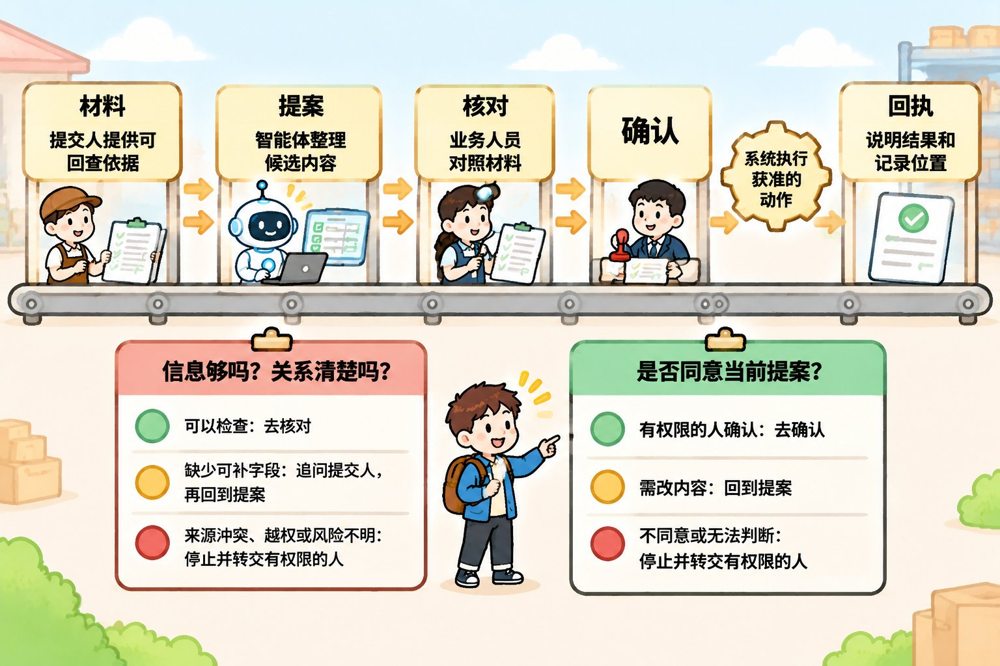

# 第 10 章 设计受控流程

客户现场，一张入库单的照片送到工作台。智能体能先整理出一份待核对的内容，可这份内容能不能直接当成已入账的事实？

这一章要解决的问题是：怎样设计一条**受控流程**（每一步谁负责、何时停下，都事先写清楚），让智能体帮忙，又让有权限的人对每次业务变化负责。

读完本章，你能为一次业务登记设计五步流程，并判断智能体什么时候应该停下、追问或转交人工。

## 本章学习目标

读完本章，你应该能：

1. 为一项会改变客户业务记录的智能体操作，写出何时停止、追问或转交人工。
2. 把一次业务登记设计成「材料 → 提案 → 核对 → 确认 → 回执」五步流程，并说明每一步由谁负责。

## 10.1 先弄明白

### 从关系图走到业务动作

上一章的关系图帮助 FDE 看清一张单据连着哪些商品、批次和动作。图能说明对象之间有什么联系，却还没有回答工作由谁开始、谁能改变记录、失败时该怎么办。客户每天需要的是一条能反复使用的工作路线，不是一次演示中看起来顺畅的对话。

这条路线就是受控流程。它把每一步的输入、负责角色、检查点和下一步条件写清楚。你可以把它想成学校借用设备。先交申请，再核对设备和人。负责人批准后才领走，最后收到办理结果。少了批准，登记得再快，也可能把设备交错人。

FDE 设计流程时先看实际工作，再选技术。哪些材料由谁提交，谁能核对，谁有权确认，都要向客户确认。

若一项任务规则固定、资料齐全，普通软件可能更合适。若需要读懂不规范材料，智能体可以先整理信息。是否值得用智能体，不能只看它能不能完成一次。

**停一下，想一想**：关系图能说明对象之间有什么联系，却还没有回答哪三件事？

看答案

工作由谁开始、谁能改变记录、失败时该怎么办。

一句话记住：受控流程要写清谁开始工作、谁能改记录、失败时怎么办。

### 五步把提议和事实分开

五步按这个顺序走：「材料 → 提案 → 核对 → 确认 → 回执」。每一步只做一类事。智能体整理待核对的内容；人判断能不能改业务记录；系统按确认结果执行，并回报结果。

**材料**是本次业务的单据或说明，必须能查回来源，也要说清它适用于哪件事。

客户发来照片，不等于照片上的字都对。同一天的两张单据，也不一定属于同一批货。FDE 要先弄清哪些材料能作依据，哪些内容还没确认。

**提案**是智能体根据材料整理出的待核内容。它可以列出单据类型、对象、数量、单位和来源，也可以标出缺了什么。它像一张要检查的草稿，不能当成已经登记的事实。提案写得越清楚，业务人员越容易对着材料检查错字、漏项和错误关联。

这一步也能帮助 FDE 判断任务说明和材料够不够。若智能体把两张单据连错，FDE 不要只让它重试。先看说明有没有讲清关联规则，再看材料有没有说明来源。补清说明和材料，才是在解决问题。

**核对**是由熟悉这项业务的人把提案与材料、规则和当前记录逐项比较。除了数字，还要检查单位、对象、批次、来源、是否重复，以及动作有没有超出范围。核对人要能看到提案依据。找不到依据的内容就标为未确认，不能靠名称或日期相近来猜。

**确认**是有权限的人看清本次对象、变更、依据和影响后，同意执行。确认必须针对准备执行的当前提案。

只要对象、数量、单位、来源或动作发生变化，就要重新展示当前提案。核对人再对照材料检查这版内容。之后有权限的人重新确认。旧确认不能代替对新提案的确认。

智能体能提出操作，不等于它该自行写入记录。

**停一下，想一想**：五步里，哪一步由有权限的人决定能不能改业务记录？

看答案

确认。有权限的人看清当前提案后，同意执行。

确认前，FDE 还要和客户核清权限。一个人可以查库存，却没有权限登记入库。另一个人可以核对，却不能批准。

客户的业务规则决定谁能做什么。FDE 不能因为智能体能调用接口，就认为用户有相应权限。系统检查权限，也不能代替人检查材料。

**回执**是操作后的结果说明。它要让提交人知道操作是否完成、对应哪条记录，还有什么待处理。操作没成功，就要说明没完成，不能只说「处理好了」。回执方便之后查找，但不能证明材料一定正确，也不能替代后续业务核对。

五步也要交代清楚谁接手。提交人给材料，智能体整理提案，业务人员核对，有权限的人确认，系统执行后回报。客户可以让同一个人核对和确认，也可以安排不同的人。FDE 要写清实际负责人，不能只写「人工处理」。

负责人也不能笼统写成「业务人员」。FDE 要和客户确认：谁交材料，谁最了解单据，谁有权批准，遇到争议找谁。岗位名称还没核实时，可以先写「客户指定的材料提交人」或「有权限的确认人」，并标明待确认。

确认时，人还要看清这次登记的内容和依据。界面要说明会改变哪条业务记录，以及哪些字段还没确认。若只显示「新增入库」，不显示对象和数量，点「同意」也说不清批准了什么。确认点要让人做得出判断，不能只留下一个按钮。

FDE 还要和客户约定，只改说明文字时怎么处理。对象、数量、单位、来源或动作只要改变，都要重新展示提案。再由核对人对照材料检查当前内容。之后由有权限的人确认，系统才可以执行这版内容。

系统还要区分「已处理」「未处理」和「结果不明」。网络断开时，不能报成已完成。结果不明时，应让负责人查询后再决定是否继续。

流程设计也要接受不同情形的检查。正常材料可以检验五步能否顺利完成；缺项材料可以检验智能体会不会问对问题。

来源冲突可以检验它会不会停下。重复提交可以检验它会不会避免重复改变记录。越权请求可以检验它会不会转交正确的人。

一次成功只说明那次输入走通，不能证明流程在这些边界下也可靠。FDE 把这些情形和处理结果留成证据，客户才能判断方案是否适合日常工作。

*图 10-1：从提交材料到业务结果的受控流程；条件不满足时先停下来。*

一句话记住：材料、提案、核对、确认、回执各管一步，改业务记录前必须有人确认。

### 缺字段时，追问还是停止

缺了信息，不一定要马上交给人。有时问一句就能补齐。FDE 要先看这项信息是否必需、谁能提供，以及能不能在确认前补上。

缺少必要信息时，如果提交人或相关凭证能回答，智能体可以追问。问题要说清缺什么、需要什么材料。不能引导对方接受智能体的猜测。

比如签收记录没有实际签收时间，就问对方能否提供可核实的时间或凭证。不能把制单日期当成签收时间。

如果材料互相矛盾，或对象、数量、单位看不清，智能体就要停下，不能改记录。它应说清矛盾在哪里，再请有权限的人判断。权限不清、请求超出本次范围，或可能造成重大影响时，也要交给人处理。有人给出结论前，提案不能变成业务记录。

FDE 可以记住三条：

1. 有人和材料能补清缺项，就追问。
2. 来源冲突或找不到依据，就停止。
3. 需要授权或业务判断，就交给相应的人。

追问也不能没完没了。要不到可靠依据，就保持待处理，不能为了完成演示继续做。

人确认后，系统也可能拒绝操作、发现重复，或突然断网。此时要告诉人结果还不确定，并让负责人检查。不要为了消掉报错连续重试；同一笔业务可能被登记两次。

AWS 的企业智能体参考架构提出，动作要经过审批；不确定时要先问清楚，或交给人处理。

Salesforce Trailhead 的「服务智能体 Superbadge」是一项技能评测。它的考核目标包括创建服务智能体、构建并测试自定义动作。它还要求更新提示模板（写给智能体的固定指令文字）、部署智能体和安排会话路由。前者是 AWS 的架构建议，后者是 Salesforce 的评测要求。这两份公司资料各自说明本公司的做法，不是所有客户都要照搬的统一规则。

做得好的流程，能让人回答四个问题：提案来自什么材料？谁检查过？谁批准了这次变更？最后发生了什么？

如果只能回答「智能体说完成了」，FDE 还没有把交接做好。下一章会继续检查流程在正常、缺项和越界情形下是否可靠。

**停一下，想一想**：签收记录缺了实际签收时间，能不能用制单日期填上？

看答案

不能。制单日期不是签收时间，应追问可核实的时间或凭证。

一句话记住：缺字段能补就追问，来源冲突或依据不足就停止，需要授权就转交有权限的人。

## 10.2 看例子

#### 例 10-1：把一次入库登记拆成五步
<!-- Bloom：分析 -->

**题目**：以下是课堂合成示例，不是客户实账。课堂记录显示，采购订单 `课堂-CG-20260801-01` 为 40 箱，采购入库单 `课堂-RK-20260801-01` 为 +40 箱。请把这次入库登记拆成材料、提案、核对、确认、回执五步，并说明每一步的负责者和判断依据。

**分析示范**：

1. **材料**：采购经办岗提供订单，收货仓管岗提供入库依据。两张记录都能查到来源，才有条件继续；单号和数量要保留原样。
2. **提案**：智能体把两条记录整理成待核草稿，标出供应商、仓库、数量和来源。它不能把草稿写成已入库事实，因为识别结果还未由人检查。
3. **核对**：收货仓管岗对照教师提供的材料，查看订单与入库记录的关联、数量单位和对象。数据集中两条记录均写 40 箱；现场是否实收仍以课堂材料为准，不能从表格额外推断。
4. **确认**：由客户指定且有登记权限的人检查当前提案，再决定是否同意本次登记。若客户没有确认收货仓管岗的权限，就由其转给有权人员。
5. **回执**：系统执行获准动作后，向提交人说明结果并指向对应记录。若未执行成功，就回报未完成和待处理原因，不虚构记录编号。

这个答案是怎么核对的

**验证**：✅ 已验证（核对指定材料与流程逻辑）

**核验记录**：贯穿案例档案第五节第 2 项及第二课讲稿 s18–s23 都把材料、提案、人工核对、确认和结果回报分开；课堂数据集“单据与关联记录”逐字支持两张单号和 40 箱。书末参考文献第 10 章第 8 条原文说明动作要经过审批或权限检查。本例把负责人写成建议分工，未声称客户已批准该权限配置。

#### 例 10-2：评估跳过核对直接入账
<!-- Bloom：评价 -->

**题目**：假设智能体读完入库材料就直接写入业务记录，之后才通知工作人员。请评估这种流程的风险，并说明五步流程中的哪个检查点能在记录改变前发现问题。

**评价示范**：

1. **看输入**：课堂数据集有一张 +40 箱的入库记录 `课堂-RK-20260801-01`，另有同日 +6 箱的入库记录 `课堂-RK-20260801-02`，后者属于独立批次。若流程只按日期或商品名称关联，直接写入可能把不同来源接在一起。
2. **看影响**：错误关联可能使库存记录和之后的追溯依据不一致。如果等写入后才发现，纠正还需要补充处理。
3. **看检查点**：材料到提案这一步只负责整理候选内容。核对步骤先比较单据来源、对象和数量；确认步骤由有权限的人批准当前提案。两道检查都放在系统动作之前，能让问题在记录改变前暴露。
4. **下结论**：跳过核对并直接入账，不适合会改变客户业务记录的流程。规则校验可以拦住部分格式问题，却不能替代人判断两张单据是否属于同一业务。书末参考文献第 10 章第 8 条描述的审批门和不确定时转交原则，也支持先停下再处理。

这个答案是怎么核对的

**验证**：✅ 已验证（核对数据来源与风险论证）

**核验记录**：课堂数据集“单据与关联记录”及“留给第 7–12 章分析的小问题”指出两笔同日入库分属不同批次，不能只凭日期或商品接在一起。书末参考文献第 10 章第 8 条原文说明动作需经过策略或审批控制；遇到不确定情况时，可先澄清或交给人处理。本例以“可能”描述后果，没有声称数据集中实际发生过错账。

## 10.3 跟着练

#### 例 10-3（引导练习）：字段缺失时先追问还是停止
<!-- Bloom：应用 -->

**题目**：课堂签收回单 `课堂-SH-20260802-01` 有签收数量，但「实际签收时间」为空。请写出智能体应追问什么；如果拿不到依据，应在哪里停止？

提示 1（方向）

先判断这个字段能不能从现有单据推出，再找谁能提供可核对的依据。

提示 2（关键证据）

数据集说明实际签收时间为空，也提醒不能仅凭制单日期认定签收时点。

完整解答

1. 应询问提交人能否提供回单上可核实的实际签收时间，或补交能支持该字段的凭证。
2. 不能把制单日期填成签收时间。
3. 如果对方没有依据、材料仍冲突，智能体就停止确认和记录变更，并把待核项转给有权限的业务人员。

这个答案是怎么核对的

**验证**：✅ 已验证（核对课堂数据集原文与停止条件）

**核验记录**：课堂数据集“留给第 7–12 章分析的小问题”第 1 项明确指出签收数量存在、实际签收时间为空，并要求不要仅凭制单日期认定时点。停止条件与本章定义的追问、停止、转交边界一致。

#### 例 10-4（引导练习）：给三步流程补上核对和确认
<!-- Bloom：创造 -->

**题目**：一位同学画了「材料 → 智能体生成提案 → 回执」三步。请补成五步流程，并给每一步安排一个负责人。

提示 1（方向）

想一想，提交的提案在产生结果之前，谁需要检查，谁有权批准。

提示 2（关键步骤）

在「提案」和「回执」之间补上「核对」与「确认」，再写明确认后由谁执行获准动作。

完整解答

1. **材料**：业务提交人提供能查到来源的单据。
2. **提案**：智能体整理候选内容并标出缺项。
3. **核对**：熟悉业务的核对人逐项对照材料。
4. **确认**：有权限的业务人员检查当前提案并批准或退回。
5. **回执**：系统说明动作是否完成及记录位置；不能完成时说明待处理事项。

若同一人同时承担核对和确认，流程图仍应分别写出两种责任。实际岗位名称由客户确认。

这个答案是怎么核对的

**验证**：✅ 已验证（核对五步定义与职责边界）

**核验记录**：本章五步定义与贯穿案例档案第五节第 2 项均将提案、核对、确认、结果回报区分开。答案没有指定未经客户确认的真实职位或系统界面。

## 10.4 自己做

先自己做，做完再翻到 [98-参考答案.md](98-参考答案.md) 对照。

以下题目是开放题。作答时要说明依据、负责人和判断边界；可以有不同设计，但不能把未确认的信息当成事实。

| 评价维度 | 达到要求的表现 |
|---|---|
| 依据清楚 | 能指出使用了哪份材料，区分已知、缺失和待确认内容。 |
| 顺序合理 | 五步没有颠倒；核对和有权限者确认都在业务记录改变之前。 |
| 责任明确 | 每一步都有负责人，能说明智能体与人的权限边界。 |
| 异常可处理 | 写清何时追问、停止或转交，回执能说明结果和待办。 |

#### 习题 10-1
<!-- Bloom：理解 -->

**题目**：开放题。用自己的话解释，为什么业务登记应由智能体提出提案、由人确认，而不是让智能体直接入账。

#### 习题 10-2
<!-- Bloom：应用 -->

**题目**：开放题。面对一张字迹不清的单据，请写出智能体可以追问的内容、必须停止的条件，以及需要转交给谁判断。不要补造单号、姓名或数量。

#### 习题 10-3
<!-- Bloom：创造 -->

**题目**：开放题。仅依据课堂数据集，为 `课堂-XS-20260802-01` 设计一次出库登记的五步流程。该单据数量为 −200 盒，客户名称写「星穗生活馆」；数据集说明它与主数据「星穗优选」是否同一客户尚未确认。列出每步负责人、核对依据，以及需要追问或停止的地方。

#### 习题 10-4
<!-- Bloom：评价 -->

**题目**：开放题。一位同学设计的流程是「材料 → 提案 → 确认 → 核对 → 回执」。评价确认点放得是否合适，并说明记录改变应发生在什么位置、哪些情况要停止或转交人工。

## 10.5 本周实训

你是 FDE，正在帮一家水果供应链客户检查入库登记。收货人员希望少抄几次单据，但库存记录改变前仍要有人核对。

**环境核验状态**：目前还没有在目标课堂环境从头到尾实测过，因此本实训暂时不能照下面的 DeepSeek Harness（dsh）和 VectA（面向水果供应链企业的 AI 业务运营平台）步骤执行。教师须在开课前实际核对并记录学员账号、隔离账套和材料入口。还要记录提案生成和人工核对的操作步骤及隔离条件。全部确认前，不开始登录、上传材料或生成提案。

**实训目标**：在课堂环境里完成材料提交、生成提案和人工核对；再为一个业务环节画出五步受控流程，标出每一步负责人。

**课时安排**：共 2 课时。第 1 课时完成材料提交、提案生成和人工核对；第 2 课时绘图、标注负责人并完成自查。

**准备**：

- 教师须按目标课堂环境实际核对并记录：电脑已预装 dsh、学员账号可以登录、账号只能访问隔离的非生产演示账套，且下列各步入口可用。未全部核实前，停止平台操作。
- 使用教师提供的课堂材料；不得上传客户原单、生产记录或个人资料。教师应先核对课堂材料与演示账套中的虚拟记录。
- 准备纸张或教师提供的流程图工作纸；智能体不需要读取学生电脑文件。

**分步操作**：

1. **登录课堂环境**：打开教师预装的 dsh，用教师发放的 VectA 学员账号进入指定课堂环境。
2. **确认账号可用**：若账号、工作区或账套不清楚，先停止并询问教师，不借用客户或教师账号。
3. **提交材料**：在教师指定的材料入口，提交教师提供的入库单据，只使用课堂虚拟记录。若入口不可用或材料与课堂账套不一致，停止上传并报告教师。
4. **请求生成提案**：请智能体按提交材料整理待核提案，把无法确认的字段列出来，并说明对应材料。不要要求它代替你确认或登记。
5. **人工核对**：由教师指定的学生或教师逐项对照材料和提案，记录一致项、缺项与疑点。
6. **停在核对**：本实训停在核对，不确认、不提交任何会改变记录的动作。
7. **画流程图**：从自己选择的业务环节出发，在纸张或工作纸上画出「材料 → 提案 → 核对 → 确认 → 回执」，在每个框旁写负责人。
8. **标出条件**：另标出缺项时的追问、停止和转交条件。

**要交的产物**：一张五步受控流程图，图中每一步都有负责人，并标明缺项时怎样追问、停止或转交人工。

**检查清单**：

- [ ] 五步名称和顺序完整。
- [ ] 材料能回到来源，提案没有被当成已登记事实。
- [ ] 核对和确认的负责人写清楚；确认人有相应权限。
- [ ] 确认发生在记录改变之前。
- [ ] 冲突、缺项和权限不明时有停止或转交办法。
- [ ] 回执能说明成功、未完成或仍待核的内容。

## 本章小结

**核心结论**：

1. 受控流程把材料、提案、核对、确认和回执连起来，并给每一步安排负责人。
2. 提案是待检查的内容，不是已登记事实；会改变业务记录的操作必须由有权限的人确认。
3. 字段缺失但能从可靠来源补齐时可以追问；证据冲突、权限不清或风险过高时应停止并转交人工。
4. 回执说明动作结果和待办事项；一次演示成功不能代替可追溯、可交接的流程。

**和全书主线的关系**：本章推进了这条主线：智能体结果不理想时，FDE 要先检查任务说明和材料是否清楚、充分；也推进了这条主线：智能体能做不等于应该让它做，改变业务记录必须由有权限的人确认，并由人对结果负责。

**自检**：回到章首的学习目标，逐条问自己做到了没有——

- [ ] 为一项会改变客户业务记录的智能体操作，写出何时停止、追问或转交人工。→ 拿不准就回看 10.1，自测：习题 10-2。
- [ ] 把一次业务登记设计成「材料 → 提案 → 核对 → 确认 → 回执」五步流程，并说明每一步由谁负责。→ 拿不准就回看 10.1，自测：习题 10-3。

**下一章预告**：第 11 章《给案例做体检》将用正常、缺项、歧义、重复和越权情形检查流程是否可靠。
