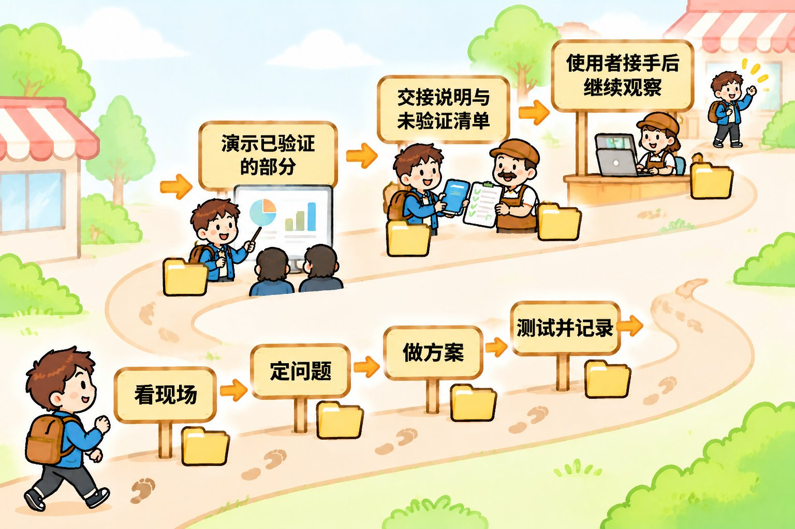

# 第 12 章 演示、复盘与交接

到了收尾，贯穿案例的档案仍把受控测试（团队在自己设定的条件下做的测试）、演示回放和客户正式验收分开记录。现有记录没有证明客户已经正式验收或在日常工作中使用。怎样才算把 AI 用进了业务，而不只是做了一次演示？

第 11 章带你用一组测试检查智能体的回答；本章要解决的是，怎样用证据说明成果与边界，再把说明交给实际使用的人。

读完本章，你能用证据区分「做到」和「未验证」，并为业务使用者写出一份操作说明。

## 本章学习目标

读完本章，你应该能：

1. 列出 FDE 一次交付的主要步骤：看现场、定问题、做方案、测试、交接。
2. 用教师课前核验过的演示账套记录，论证案例做到了什么、没有验证什么。
3. 为业务使用者写一份操作说明，写明适用范围、需要人工检查的地方和求助方式。

## 12.1 先弄明白

### 收尾先看业务结果

**演示**，是在限定条件下向别人展示一条流程怎样运行。就像社团迎新时，学长在一台电脑上把报名流程走一遍给新生看。它能让使用者看见结果，也能暴露操作不顺的地方。但一次演示成功，不等于客户每天都能靠它完成工作。

**交付**，是把能用的方案、操作说明和待核事项交给客户团队。就像社团换届，老社长要把活动表和联系人交给下一届，对方才接得住。接手的人要知道从哪里开始，看到什么结果，遇到问题怎样停下来。若这些信息还在 FDE 脑中，交付就没有真正完成。

FDE 因此不能把「屏幕上出现了一个答案」当作最后结论，你要继续问：答案来自哪张记录？哪些步骤已经走过？谁看过结果？还缺什么证据？

OpenAI 对 FDE 工作的介绍，把流程发现、成功定义、生产验证和复用放在一条路径上。[1]Intuit 的一个岗位说明把工作写到上线、培训、文档和持续支持。[2]这是一家公司的岗位说法，不代表所有公司分工都相同。它提醒我们，写完功能只是其中一步，使用者能接手也要算在交付里。

一句话记住：演示和功能都不等于交付，使用者能接手才算完成。

### 把结论分成两栏

**复盘**，是工作告一段落后，回看目标、过程和材料，再写出结果的过程。就像社团办完活动，对照报名表和签到表写总结。复盘不是挑最好看的截图。它要同时回答两个问题：现在有什么证据支持？还有哪些问题没有证据回答？

「做到」一栏只写已有记录直接支持的事实。每条事实最好能找到来源单据、字段或测试记录。来源越清楚，别人越容易复查。

「未验证」一栏写材料暂时回答不了的事。例如记录没有时间字段，就不能推断准确的交接时间。数量能对上，也不等于实物已盘点。智能体曾经回答一次，也不等于它经受过一组不同情形的测试。

这两栏能防止把推测写成结论。做到了什么，是证据的边界；没有验证什么，是下一步工作的入口。它们并不互相抵消。诚实保留未知，能让接手的人避开错误假设。

写两栏前，你可以先逐条问三个问题。第一，这句话是在描述一条记录，还是在解释记录？第二，读者能不能从这句话找到原始材料？第三，材料有没有说明适用的时间、对象和流程？

如果解释比记录多走了一步，就把那一步写成推断，并说明还需要什么材料确认。

例如，单据写了签收数量，只能支持数量这个事实。若它没有签收时间，不能用单据日期替代。若两张单据的客户名称不同，也不能因为它们看起来相似，就直接认定为同一客户。把缺口写在旁边，比替它补一个听起来合理的答案更有用。

展示前也要先选一个明确的问题。你是要说明单据能否串起来，还是要说明使用者能否完成一个操作？

这两种展示需要不同的证据。前者要把单据关系画清楚；后者还要让使用者亲手复核步骤。问题说得越具体，观众越容易判断结果是否有用。

**停一下，想一想**：记录里没有签收时间，能不能用单据日期代替？

看答案

不能。没有签收时间，就不能用单据日期替代，要把缺口写在旁边。

一句话记住：「做到」要有来源，「未验证」要老实写出来。

### 证据要和说法一一对应

**结项说明**，是项目收尾时写的总结。它常把几类说法写在一起：系统做过什么，业务记录显示什么。客户是否认可，价值是否已经出现，也常在同一段里。它们需要的证据并不相同。

设计稿能说明团队打算怎样做。代码能说明某项能力已写进系统。测试记录能说明某条路径在特定环境下走过。真实使用记录能说明有人用过。

客户共同验收的材料，才能支持正式验收的结论。

比如社团宣传说「今年报名的人多了很多」，就要拿出报名表和去年的表来对。

你可以把每句话拆成一个小检查。先圈出事实，再找对应记录。找不到记录时，就改成「待验证」，或删去这句话。记录支持一部分时，只保留支持的那部分。

贯穿案例的时间线就是一个例子。档案记有隔离测试、方案决定、受控测试和演示回放。它也说明演示遇过失败，且没有找到正式客户验收记录。因而可以说「已有若干测试和演示记录」，不能说「客户已全面上线并验收」。

这不是否定团队已做的工作，而是让每个结论落在证据够得着的地方。

**停一下，想一想**：如果一句话写「客户已经全面上线并验收」，应该先找什么材料？

看答案

先找客户共同验收的材料。只有这类材料，才能支持正式验收的结论。

一句话记住：每句结论都要对应一条记录，找不到就写成待验证。

### 演示与测试也有范围

演示回答的是：「这条流程能不能向某位使用者展示？」它通常有指定材料、指定步骤和现场人员协助。演示成功很有价值，但它只说明当时的条件下出现了结果。

测试回答的是：「这类任务在不同输入下能不能稳定完成？」第 11 章已经练过正常、缺信息和超范围的问题。交接时应把测试条件、实际结果和未通过项一起交给接手者。不能只留下最顺的一次。

业务结果回答的是：「目标使用者是否在真实工作里用它完成任务？结果有没有达到事先约定的标准？」这需要实际使用记录、业务人员反馈和开工前的基线（开始前的原始数字）。就像社团想知道新的报名方式好不好，得拿改之前的报名记录来比。若材料没有这些证据，就不要写效率提高或错误减少。

因此，成果展示最好从一条证据链开始，而不是从产品功能清单开始。

一段清楚的展示可以按三个动作展开。先用一句话说业务人员要完成什么工作。再沿着材料展示输入、判断和结果各自在哪里。最后把结果分成已证实和仍待确认两类。

观众看到的不是功能越多越好，而是每个结论能否对回原始记录，流程在哪一步需要人判断。

展示时还要说清楚演示条件。你用了哪一套数据，哪段流程由人协助，哪些字段是演示前准备好的？这些条件会影响别人能否复现结果。把它们讲出来，观众才不会误以为：特定条件下的成功，换谁、换什么数据都能得到。

**停一下，想一想**：演示很顺利，能不能直接写「效率提高了」？

看答案

不能。效率提高要有实际使用记录和开工前的基线，材料没有这些证据时就不要写。

*图 12-1：从现场到交接，每一步都留下可以对照的依据。*

一句话记住：每个结论都要能对回记录，展示时还要说清条件和边界。

### 交接说明要让别人能操作

**操作说明**，是写给实际使用者的工作指南。它不该只告诉人「点哪里」。还要说清这份说明适用于什么任务、要准备哪些材料，并写明遇到哪种情况必须停下。就像社团的报名指南，只写「点哪里」，新生遇到证件不齐时还是不知道怎么办。

第一，写适用范围。说明对应哪个业务流程、哪类记录和哪种使用情境。范围外的问题不能照抄这套步骤。

第二，写开始条件和操作步骤。每一步用日常词语说明要查看什么、记录什么。若数据来源不完整，步骤应要求使用者先找人核实。

第三，写结果怎样核对。说明结果对应哪一张业务单据、哪几个字段。不要只写「系统显示成功」。使用者要能从结果回到来源。

第四，写**人工检查点**。这是流程里必须由人核对才能继续的地方。客户、商品、单位、数量、日期或权限有疑问时，使用者要能看出问题并知道暂停。智能体可以整理候选内容；会改变业务记录的动作仍须由有权限的人确认。

第五，写求助方式。使用者应知道找哪个岗位、用哪个客户认可的渠道，以及要带上哪些信息。联系人或渠道若还未确定，就标成上线前待补，不要自己编一个名字。

一句话记住：操作说明要让人照着做得下去，也要让人知道什么时候停、去找谁。

### 把人的责任留在流程里

交接文档不能把责任推给一个按钮。能查询的信息和会改变业务记录的操作，影响不同。后一种操作要展示对象、变更内容和依据，再交给有权限的人确认。确认人也要知道自己在确认什么。就像社团报销，发票要财务看过，再由有权限的人签字，学长一句「我看过了」不算数。

人工检查不是每一步都机械点「同意」。否则人会逐渐忽略提示。真正有用的检查点会说清要核对什么、发现问题时怎么办，以及谁有权继续。

一句话记住：人要确认的是对象、内容和依据，不是一个「同意」按钮。

### 收尾之后还有什么

交接不代表项目再也没有后续。监控、用户采用、业务价值测量和经验复用，都是后续工作可能涉及的方向。本章只提示这些方向，不把它们写成已经完成的成果。

Anthropic 公布的培训安排包含模拟部署和从用例到交接的练习。新情境考核也在其中。[3]这也说明，收尾不是额外的文书活，而是检验你能不能把工作交给别人的一部分。

一句话记住：交接做得好，工作才算真正做完。

## 12.2 看例子

以下是课堂合成示例，不是客户实账，也不是演示账套导出的记录。它只用来练习怎样看证据，不能作为学习目标 2的考核材料。学习目标 2 必须使用教师课前核验过的演示账套记录。⚠️ 需作者确认（开课前核对演示账套实际记录；课堂合成数据不能代替 学习目标 2 考核材料）

#### 例 12-1：审阅一份结项说明
<!-- Bloom：评价 -->

**题目**：读下面这份结项说明。指出哪些说法有记录支持，哪些说法缺少证据。请为判断写出理由。

> 结项说明草稿：40 箱货已经翻箱成 456 盒，24 盒差额的原因已查清。客户已按约定时间收到 200 盒。日结余额为 252 盒，账实一致。智能体已经可靠处理客户的日常业务，可以正式上线。

**解**：

1. 先识别材料性质。这是一份待审的结项说明，不是原始单据。它既有可以核对的说法，也有结论性说法。
2. 再核对翻箱。课堂仿真单 `FX-2026-0801-01` 记有投入 40 箱、产出 456 盒。按数据集给出的箱规换算，理论数量是 480 盒，相差 24 盒。
3. 材料没有给出差额原因，因此「差额原因已查清」没有证据。
4. 再检查交付时间。课堂仿真出库单 `课堂-XS-20260802-01` 记有发出 200 盒。签收回单 `课堂-SH-20260802-01` 记有签收 199 盒，但「实际签收时间」为空。
5. 退货入库单 `课堂-TH-20260802-01` 记有退回 1 盒。补发出库单 `课堂-XS-20260803-01` 和补发回单 `课堂-SH-20260803-01` 分别记有发出和签收 1 盒。
6. 这些记录不能支持「按约定时间收到」，因为数据没有给出约定时间。
7. 再检查库存结论。日结对账表 `课堂-DZ-20260803-01` 列出暂结余额 252 盒。按翻箱单、退货单、出库单、报损单和质检记录的数量，可以回算到这个余额。
8. 但没有实物盘点凭证，不能把「暂结余额」扩大成「账实一致」。
9. 最后检查智能体和上线结论。课堂数据集只有业务记录，没有智能体输出、持续使用记录或客户验收记录。
10. 因而它不能证明智能体可靠处理了日常业务，也不能证明可以正式上线。

有边界的结论是：课堂记录支持翻箱产出、部分交付和一笔暂结余额；差额原因、首次签收时点、实物库存、智能体日常表现和客户验收都还没有被这些材料验证。

这个答案是怎么核对的

**验证**：✅ 已验证（对照课堂数据集的单据与数量自查）

~~~text
核验记录：
- `FX-2026-0801-01`：虚构批次-L01 投入 40 箱，虚构批次-L02 产出 456 盒。
- 数据集给出的理论换算为 40 箱 × 12 盒/箱 = 480 盒，差额为 24 盒；原因未提供。
- `课堂-XS-20260802-01`：出库 200 盒；`课堂-SH-20260802-01`：签收 199 盒，实际签收时间为空。
- `课堂-TH-20260802-01`：退货入库 1 盒；`课堂-XS-20260803-01`：补发出库 1 盒；`课堂-SH-20260803-01`：补发签收 1 盒。
- `课堂-DZ-20260803-01`：暂结余额 252 盒，不是实物盘点凭证。
- 数据集没有智能体输出、日常使用或正式验收记录。
- 以上单号属于课堂合成数据，不是演示账套证据，不能用于 学习目标 2 评分。
~~~

回顾：这道研读用到了逐项匹配证据、区分记录和推断、再限定结论范围的方法。

#### 例 12-2：检查一份交接材料
<!-- Bloom：分析 -->

**题目**：分析下面的短交接稿。业务使用者会在哪些地方卡住？请按「缺了什么—会造成什么问题」说明。

> 查询库存后记录为 252 盒。照常处理，核对后提交。有问题找管理员。

**解**：

1. 先看它交给谁。材料没有写使用岗位和适用情境。仓管人员和财务对账人员可能面对不同的记录，读者不知道自己是不是目标使用者。
2. 再看开始条件。「查询库存」没有说明要选哪一批、哪段日期或哪些来源记录。使用者无法判断 252 盒对应哪个对象，也无法回到原单复核。
3. 再看核对要求。「照常处理」没有说核对哪些字段。课堂数据中有客户名称别名、签收时间缺失、退货数量和单位冲突等情况。说明没有告诉使用者碰到它们应暂停还是继续。
4. 再看操作权限。「核对后提交」没有说明提交会不会改变业务记录，也没有指定有权限的确认人。使用者无法判断自己能否提交。
5. 最后看求助方式。「管理员」没有岗位、渠道和所需信息。遇到问题的人不知道找谁，也不知道怎样把问题讲清楚。

因此，短交接稿既不能指导操作，也不能保护使用者免于把未核实内容带入下一步。它至少还需要范围、开始条件、逐步操作、证据位置、人工检查、停止规则和明确的求助方式。

这个答案是怎么核对的

**验证**：✅ 已验证（逐项对照交接材料必需信息与课堂数据中的未决项）

~~~text
核验记录：
- 短稿没有目标岗位、适用范围、流程条件、来源位置、检查字段或停止规则。
- “管理员”没有可识别岗位或联系渠道。
- 课堂数据集明确列出签收时间为空、客户别名未确认、退货草稿数量与单位待核等问题。
- 结论只指出材料缺项及其使用影响，没有补造联系人或业务步骤。
~~~

回顾：这道研读用到了拆解材料结构、找出缺项和推断使用影响的方法。

## 12.3 跟着练

以下仍使用课堂合成数据练习证据分类，不作为 学习目标 2 的考核材料。正式完成 学习目标 2 时，要改用教师课前核验过的演示账套记录。⚠️ 需作者确认（演示账套实际记录待开课前核验）

#### 例 12-3：把成果放进两栏
<!-- Bloom：应用 -->

**题目**：先用课堂合成数据练习，把案例结果填入「做到了什么」和「没有验证什么」两栏。每项都要附上单号和字段。不要把暂结数字写成客户验收结论。这项练习不能代替 学习目标 2；学习目标 2 要使用教师课前核验过的演示账套记录。

提示 1（切入视角）

先沿着一条业务记录链整理已出现的单据，再找出字段缺失、数量冲突和档案没有覆盖的结论。

提示 2（关键证据链）

把翻箱投入与产出、出库与签收、退货与补发、报损与质检、日结余额分开核对。未过账的草稿要单独标出。

完整分析

**做到了什么**：

- 翻箱单 `FX-2026-0801-01` 记有投入 40 箱、产出 456 盒。
- 出库单 `课堂-XS-20260802-01` 记有发出 200 盒；签收回单 `课堂-SH-20260802-01` 记有签收 199 盒。
- 退货入库单 `课堂-TH-20260802-01` 记有退回 1 盒。补发出库单 `课堂-XS-20260803-01` 和补发回单 `课堂-SH-20260803-01` 记有补发、签收各 1 盒。
- 报损单 `课堂-BS-20260803-01` 记有报损 3 盒；质检记录 `课堂-ZJ-20260803-01` 记有领用 1 盒。
- 日结表 `课堂-DZ-20260803-01` 列出暂结余额 252 盒。按以上记录计算，退回的 1 盒与补发的 1 盒相抵，算式与数据集相符。

**没有验证什么**：

- `FX-2026-0801-01` 显示理论数量比实点产出多 24 盒，但差额原因没有记录。
- `课堂-SH-20260802-01` 的「实际签收时间」为空。
- 主数据写「星穗优选」；`课堂-XS-20260802-01` 和 `课堂-DZ草稿-20260803-01` 写「星穗生活馆」。两种名称是否指同一客户，尚未确认。
- `课堂-DZ草稿-20260803-01` 是未过账草稿，数量写 12、单位为空。它与 `课堂-TH-20260802-01` 记载的 1 盒退货不一致，不能计入余额。
- `课堂-DZ-20260803-01` 是暂结表，不是实物盘点凭证。数据集也没有智能体输出、日常使用或正式验收记录。因此这些课堂记录不能证明 AI 已可靠上线。

以上单据号来自课堂合成数据，只用于练习怎样把证据和结论对应起来，不能作为 学习目标 2 的演示账套证据。

**验证**：✅ 已验证（对照课堂数据集原始记录及数量自查）

~~~text
核验记录：
- `FX-2026-0801-01` 记载投入 40 箱、产出 456 盒；数据集数量自查列出理论 480 盒、差额 24 盒待查。
- `课堂-XS-20260802-01`、`课堂-SH-20260802-01`、`课堂-TH-20260802-01`、`课堂-XS-20260803-01`、`课堂-SH-20260803-01` 的数量与数据集相符；首次签收时间字段为空。
- `课堂-BS-20260803-01` 记 3 盒，`课堂-ZJ-20260803-01` 记 1 盒，`课堂-DZ-20260803-01` 列暂结余额 252 盒。
- `课堂-DZ草稿-20260803-01` 是未过账草稿，数量 12、单位空白，不纳入余额。
- 题目要求将证据与未验证事项分栏；答案没有声称正式上线或客户验收。
- 上述编号只在课堂合成数据中核对，不是 学习目标 2 的实际演示账套证据。
~~~

#### 例 12-4：写出人工检查一节
<!-- Bloom：创造 -->

**题目**：为业务使用者的操作说明写一节「哪些地方需要人工检查」。至少写明检查对象、检查依据和遇到冲突后的动作。

提示 1（切入视角）

从会改变结论或业务记录的地方入手。先找出需要人的判断，再写清理由。

提示 2（关键证据链）

检查客户名称、单位和数量、签收时间、差额原因，以及智能体建议是否有来源。把「停止核实」写成具体动作。

完整分析

**哪些地方需要人工检查**

- 客户名称不一致时，先核对主数据和往来单据。不能仅凭名称相近就认定是同一客户。
- 退货数量或单位对不上时，先查看已验收的退货入库单。未过账草稿不能直接算入库存。
- 签收记录缺少实际时间时，只能报告记录中的签收数量。不要根据制单日期推断签收时点。
- 翻箱数量出现差额时，先保留差额并查找来源。没有凭证前，不要自行改成报损。
- 智能体给出的结论要能指回对应记录。来源缺失或材料冲突时，暂停后续操作，交由有权限的人核实。
- 任何会改变业务记录的操作，都由有权限的人检查对象、内容和依据后再确认。

**验证**：✅ 已验证（对照课堂数据集的四个待查问题与交接原则）

~~~text
核验记录：
- 名称别名、签收时间、退货单位与数量、同日另一批次均为数据集中列出的待查问题。
- 数据集说明差额原因未提供，未过账草稿不能纳入余额。
- 业务记录变更须由有权限的人确认；答案把冲突处理为暂停核实，没有建议代替人作决定。
~~~

## 12.4 自己做

先自己做，做完再翻到 [98-参考答案.md](98-参考答案.md) 对照。

#### 习题 12-1
<!-- Bloom：记忆 -->

**题目**：列举 FDE 一次交付的五个主要步骤，并为每一步写出本书对应的章节。

#### 习题 12-2
<!-- Bloom：评价 -->

**题目**：只使用教师课前核验并发给你的演示账套记录，说明贯穿案例做到了什么、没有验证什么。每条结论都要写出单号和对应字段。课堂合成数据不能代替这项 学习目标 2 考核。若教师没有提供已核验的演示账套记录，请标出缺少的材料并向教师确认，不要用课堂示例补答。

#### 习题 12-3【Bloom：创造】（开放题）

**题目**：为业务使用者写一份操作说明。说明适用范围、开始条件、操作步骤、结果核对、人工检查点和求助方式。使用者要能照着说明完成工作，并知道哪些情况要暂停。

#### 习题 12-4【Bloom：评价】（开放题）

**题目**：回答「怎样才算把 AI 用进了业务？」并用贯穿案例支持你的判断。要区分一次演示、受控测试和客户日常使用，并说明判断所需的证据。

以下评价标准供习题 12-3 和 12-4 使用。它评的是证据、边界和实际交接能力，不评篇幅或排版。

| 维度 | 充分 | 需要补充 | 尚未说明 |
|---|---|---|---|
| 结果与证据 | 每条业务结论都指向记录；业务价值结论有基线与使用证据 | 有记录，但部分结论缺少来源或范围 | 主要依赖演示印象或无来源的说法 |
| 未验证事项 | 写明字段缺失、冲突和未覆盖情形，并说明影响 | 写出部分未知事项，但没有说明后果 | 把未知事项写成已解决 |
| 操作与人工责任 | 步骤可照做；人工检查点和停止规则明确 | 有步骤和检查，但谁确认或何时停止不清 | 让智能体或使用者在不明权限下直接改变记录 |
| 接手与求助 | 目标使用者、求助岗位和渠道均明确；未定信息标明待补 | 写出使用者或求助方式，但信息不完整 | 使用者不知道找谁或下一步做什么 |

## 12.5 本周实训

### 实训情境

你是 FDE，客户是一家水果供应链企业。你要回放一条业务流程，再把结果讲给使用者听。这是交付中的演示和交接。

### 实训目标

完成一次有证据的案例展示，再交操作说明和「做到 / 未验证」清单。另一组同学要能照着说明复核结果。你也要指出哪些结论还不能下。

### 准备

开课前，教师先确认本次课堂实际具备哪些条件：电脑、dsh（课堂使用的实验平台）、VectA 学员账号、课堂工作区、隔离账套和只读权限。当前资料没有确认学员账号和课堂账套规程，登录、查询、对话和隔离流程也没有在课堂环境实测。未确认前，不登录 VectA，不打开账套，也不粘贴业务记录。⚠️ 需作者确认（开课前核验课堂环境和数据隔离）

环境确认后，教师再发放可用记录摘录、空白操作说明表和展示用白板或纸张。不要使用客户生产资料。如果课堂暂时没有经过核验的演示账套，就用本章课堂合成数据在纸面完成证据分类和说明草稿。纸面练习不能代替 学习目标 2 考核。

### 分步操作

1. 只有教师确认账号和工作区可用后，才按课堂操作卡打开 dsh。未确认时，不登录，改用纸面数据。
2. 用自己的 VectA 账号登录，并看清账号显示的工作区。看错工作区时，不切换账套，改用纸面数据。⚠️ 需作者确认（操作未在课堂环境实测）
3. 只有教师确认账套已隔离后，才打开演示账套。没有确认时，只用教师发放的纸面数据。⚠️ 需作者确认（操作未在课堂环境实测）
4. 选一条能找到前后单据的流程，只查记录，不新增、修改或删除数据。
5. 把每一步的角色、单据、字段和来源位置记下来。
6. 若课堂 dsh 对话已确认可用，就使用教师提供的任务说明，只粘贴获准用于课堂的脱敏摘要。
7. 让智能体按「做到了什么 / 没有验证什么」整理提纲，并标出依据。不要让它补空字段，也不要让它替你判断业务。
8. 若对话未确认可用，就根据纸面数据手工整理提纲，不要把记录粘贴到未核验的系统。⚠️ 需作者确认（操作未在课堂环境实测）
9. 把提纲逐条与教师确认的账套记录或发放的课堂记录核对。
10. 找不到来源、字段冲突或超出流程的说法，放进「未验证」栏，或直接删掉。
11. 需要人工判断的地方，写明由哪个有权限的岗位确认。⚠️ 需作者确认（操作未在课堂环境实测）
12. 面向另一组同学做展示，先说清业务流程，再展示一条能对回原始记录的证据链。
13. 最后说明限制和待核事项。一次演示不能称为客户正式验收。⚠️ 需作者确认（操作未在课堂环境实测）
14. 根据同学复核时遇到的困难，补全操作说明。写清适用范围、开始条件、每步动作、结果核对、人工检查、停止规则和求助方式。
15. 岗位或渠道还没定，就标成上线前待补。⚠️ 需作者确认（操作未在课堂环境实测）

### 要交的产物

- **案例展示**：说明所选流程，展示关键记录及来源，并列出未验证事项。
- **操作说明**：写给实际业务使用者，步骤可复核，并写明检查、停止和求助方式。
- **「做到 / 未验证」清单**：每项附证据或待核原因；不要加入资料没有支持的价值结论。
- **选做**：补一份「展示后发现的问题」记录。选做时一并交上问题、来源位置和下一步核实方式。

### 检查清单

- [ ] 若使用系统，只在教师确认隔离的演示账套中查询；未确认时改用纸面数据，没有使用客户生产资料。
- [ ] 纸面合成数据的结果标为方法练习，没有用作 学习目标 2 考核证据。
- [ ] 每个事实都能回到记录、字段或测试结果。
- [ ] 把记录事实、推断和未验证事项分开。
- [ ] 对名称、数量、时间、权限和来源冲突写了人工检查办法。
- [ ] 说明了哪些操作不能自行提交，以及谁可以确认。
- [ ] 接手者能找到求助岗位或明确看到仍待指定的信息。
- [ ] 展示没有把跑通一次说成日常业务已可靠使用。

## 本章小结

**核心结论**：

1. 演示能展示一次流程，不能替代日常使用和业务结果证据。
2. 结项结论要逐句对应来源；证据够不到的内容写成未验证。
3. 操作说明要写范围、步骤、人工检查、停止规则和求助方式。
4. 会改变业务记录的动作要由有权限的人检查并确认。

**和全书主线的关系**：本章推进了这条主线：FDE 要以客户日常能否完成工作衡量成果；也推进了这条主线：别人能照说明操作、知道求助方式，并清楚哪些还没验证，交付才算完成。

**自检**：回到章首的学习目标，逐条问自己做到了没有：

- [ ] 列出 FDE 一次交付的主要步骤：看现场、定问题、做方案、测试、交接。→ 拿不准就回看 12.1，自测：习题 12-1。
- [ ] 用教师课前核验过的演示账套记录，论证案例做到了什么、没有验证什么。→ 拿不准就回看 12.3，自测：习题 12-2。
- [ ] 为业务使用者写一份操作说明，写明适用范围、需要人工检查的地方和求助方式。→ 拿不准就回看 12.1，自测：习题 12-3。

**全书收束**：FDE 从看见真实工作开始，到让使用者能够接手结束。把每个结论放回证据，把每个未知留在清单里，把下一步交到负责的人手上，工作才真正走出了演示现场。

## 参考文献

[1] OpenAI. Forward deployed engineering for enterprise AI[EB/OL]. [引用日期：2026-11-13]. https://openai.com/business/forward-deployed-engineering/.

[2] Intuit. Staff Forward Deployed Engineer, AI-Powered Work at Intuit[EB/OL]. Job ID 24599. [引用日期：2026-11-13]. https://jobs.intuit.com/job/mountain-view/staff-forward-deployed-engineer-ai-powered-work/27595/102340338848.

[3] Anthropic. Claude Frontier Academy: $100M to train 10,000 engineers[EB/OL]. [引用日期：2026-11-13]. https://www.anthropic.com/news/claude-frontier-academy.

